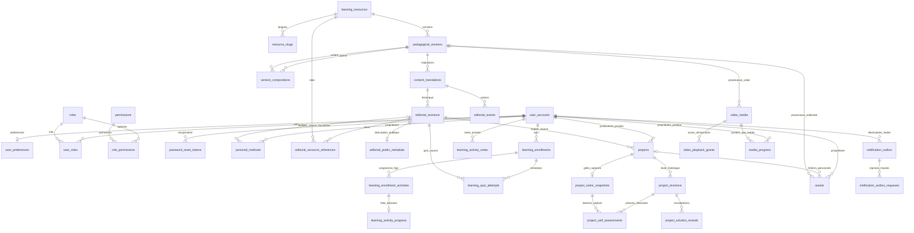

# Modèle relationnel — socles P03 à P10

Les migrations sont la définition exécutable du schéma. Ce document distingue les tables implémentées des extensions à créer dans les lots métier. V009/V010/V011 sont validées localement en P10 : **138 tests Java globaux**, ciblé identité **6/6 sous `MAIL_MODE=disabled`**, ciblé stockage final **8/8 à 24 slots** et **12/12 scénarios Chromium**. Les ciblés complètent le global sans s’ajouter à son décompte. Les preuves de chaque lot indiquent le niveau réellement exécuté.

## Identité et contenu présents

V001 conserve les deux tables officielles de Spring Session JDBC 4.1.1. V002 ajoute douze tables, sans données de démonstration et sans mécanisme concurrent de création automatique. V003 ajoute deux tables de sécurité, la version d’authentification et des références de permission. V004 étend les instantanés éditoriaux et ajoute deux tables d’historique et de références. V005 ajoute les métadonnées publiques par révision et les instantanés de revue/source publiées. V006 ajoute les méthodes personnelles ; V007 ajoute suivi, notes et tentatives ; V008 ajoute productions et preuves déclaratives. V009 ajoute le registre de fichiers, V010 l’outbox durable et ses reprises, V011 les vidéos locales de test et positions. V001 à V008 restent inchangées par P10.

| Table | Identité et relations | Invariants |
| --- | --- | --- |
| `user_accounts` | UUID, email normalisé unique, empreinte de mot de passe, statut, version d’authentification V003 | Inscription réelle en P04 ; statut anonymisé sans identifiants de connexion ; ni hash ni entité retournés au navigateur |
| `user_preferences` | UUID, FK utilisateur unique | Locale FR/EN, fuseau explicite ; ressource révisable distincte du compte |
| `roles`, `permissions` | UUID et code stable unique | Autorisations éditoriales et financières séparables ; aucun rôle fourni par un navigateur ne fait autorité |
| `user_roles`, `role_permissions` | UUID par attribution, FK explicites, révocation | Unicité des attributions actives, historique conservé ; révoquer ne réécrit ni ne supprime l’origine |
| `learning_resources` | UUID stable, type COURSE/MODULE/ACTIVITY/GUIDE/METHOD_TEMPLATE ; origine de duplication éventuelle | L’identité, le type et l’origine ne changent pas avec le titre, la langue ou le slug ; archivage distinct de suppression |
| `pedagogical_versions` | UUID, FK ressource, numéro unique par ressource ; version remplacée éventuelle | Objectifs et définition d’évaluation ; gel irréversible après construction ; changement pédagogique ⇒ nouvelle version UUID ; remplacement limité à la même identité |
| `version_compositions` | UUID, FK version parent/enfant, position | COURSE→MODULE→ACTIVITY ; enfant et position uniques par parent ; composition conservée pour chaque version |
| `resource_slugs` | UUID, FK composite ressource/type, langue, slug | Unique `(type, locale, slug)` et `(resource, locale)` ; slug canonique de l’identité, indépendant de la version |
| `content_translations` | UUID, FK version pédagogique, locale ; source, révisions examinées, date de vérification | Unique `(version, locale)` ; état éditorial et pointeurs de révision courante/publiée révisables ; langue source différente sur la même version |
| `editorial_revisions` | UUID, FK traduction, numéro, auteur éventuel, document JSONB, motif et révision remplacée | Instantané append-only ; numéro unique par traduction ; aucun UPDATE/DELETE d’une révision historique ; remplacement limité à la même traduction |
| `editorial_events` | UUID, traduction, révision concernée, acteur obligatoire, type, motif et date | Journal append-only des actions éditoriales ; FK de révision composite avec sa traduction |
| `editorial_resource_references` | PK composite `(revision_id, resource_id)` et deux FK RESTRICT | Projection append-only des liens du document vers les identités réelles ; aucune réécriture d’un lien historique |
| `editorial_public_metadata` | PK `revision_id`, FK RESTRICT vers une révision, description publique JSONB et date UTC | Une description par instantané éditorial ; UPDATE/DELETE refusés ; aucune donnée commerciale créée |
| `personal_methods` | UUID, propriétaire FK, texte/paramètres/notes/langue propres, origine éditoriale facultative avec FK composites | Compteur de révision, propriétaire et origine immuables ; aucune cascade depuis une publication ou un droit |
| `learning_enrollments` | UUID, propriétaire, parcours/version exacts, dénominateur et dernière visite | Unique propriétaire/version ; inscription de suivi distincte d’un droit acheté |
| `learning_enrollment_activities` | UUID, inscription, module/version, activité/version, ordre et titre capturés | FKs de composition et snapshot immuable ; versions distinctes comptées une seule fois |
| `learning_activity_progress` | UUID, FK composite inscription/version d’activité, lecture et fin déclarées | Unique par item, révision/ETag propre ; aucune validation de quiz/projet déduite |
| `learning_activity_notes` | UUID, propriétaire, activité/version et langue originale | Unique propriétaire/version, texte privé révisable ; origine/langue immuables |
| `learning_quiz_attempts` | UUID, propriétaire/inscription/item, traduction/révision source et snapshot corrigé | Append-only ; soumission idempotente et numéro de tentative uniques, score serveur |
| `projects` | UUID, propriétaire, origine activité/version/traduction/révision/langue, inscription facultative et révision personnelle courante | Unique propriétaire/creationId et empreinte du corps ; propriétaire et origine immuables ; ETag de texte distinct des faits d’évaluation |
| `project_revisions` | UUID, projet, numéro, champs personnels JSONB, stade et auteur | Append-only ; auteur propriétaire par FK composite ; révision courante limitée au même projet |
| `project_rubric_snapshots` | UUID unique par projet, source/langue, cas, critères et politique capturés | Vingt points, quatre erreurs, seuil 1..20 ; origine du même projet par FK composite ; append-only |
| `project_self_assessments` | UUID, propriétaire/projet/révision/grille, submissionId et empreinte, déclarations et score | Append-only ; même projet/propriétaire/grille ; seuil et besoin de révision cohérents ; aucune revue humaine |
| `project_solution_reveals` | UUID, propriétaire, révision personnelle, source/langue et date | Trace unique, append-only ; aucun corps de corrigé stocké, aucun effet sur progression ou score |
| `assets` | UUID, propriétaire, projet ou provenance éditoriale ressource/version/langue, clés S3 serveur et métadonnées vérifiées | Propriété et identité immuables ; READY/REJECTED/EXPIRED finaux ; clé READY distincte du staging ; aucun antivirus déduit |
| `notification_outbox` | UUID, propriétaire, clé métier unique, type, empreinte HMAC et charge AES-GCM | Origine immuable ; purge irréversible du ciphertext ; bail/reprise distincts de la réception SMTP finale |
| `notification_outbox_requeues` | UUID, notification, acteur, état précédent, motif et reconnaissance du risque de doublon | Journal append-only ; une issue INDETERMINATE ne se renvoie pas automatiquement |
| `video_media` | UUID, provenance version/ressource/langue, auteur, durée/taille/hash mesurés, textes facultatifs | Registre immuable LOCAL_TEST, aucune vidéo ou durée auto-créée |
| `video_playback_grants` | UUID, média FK, empreinte de bearer unique, propriétaire nullable, dates | Token brut jamais stocké ; liens courts, lignes expirées purgées par lots bornés |
| `media_progress` | PK propriétaire/mediaId, position, révision et date | Position finie bornée à la durée du média ; aucune position transposée entre deux pistes FR/EN |

GUIDE et METHOD_TEMPLATE sont des feuilles éditoriales depuis V004. Depuis P07, une définition de méthode appartient au document JSONB de sa révision ; la copie personnelle reste distincte dans `personal_methods`. Ces structures ne créent aucun prix, droit payant ou contenu pédagogique final.

## Identité et récupération — V003 / P04

[`V003__account_security_and_password_recovery.sql`](../apps/api/src/main/resources/db/migration/V003__account_security_and_password_recovery.sql) complète le schéma existant sans réécrire V001/V002. Les rôles, permissions et préférences réutilisent leurs tables P03 ; aucun second magasin d’identité n’est créé.

| Élément livré | Types, clés et relations | Contraintes PostgreSQL |
| --- | --- | --- |
| `user_accounts.authentication_version` | `BIGINT NOT NULL DEFAULT 0` ; distinct de la `revision` optimiste JPA | Borné à `0..9007199254740991` ; ne peut pas diminuer ; un changement de `password_hash` ou `status` impose au moins l’ancienne version + 1 |
| `password_reset_tokens` | PK UUID générée ; `user_id` UUID NOT NULL → `user_accounts(id)` **ON DELETE RESTRICT** ; `token_hash CHAR(64)` unique ; version d’authentification capturée à l’émission | Empreinte de 64 caractères hexadécimaux minuscules ; version bornée comme le compte ; dates UTC finies, `expires_at > created_at`, consommation nullable mais `consumed_at >= created_at` |
| `identity_rate_limits` | PK `bucket_key CHAR(64)`, début de fenêtre `TIMESTAMPTZ`, compteur entier ; aucune FK utilisateur | Clé hexadécimale minuscule de 64 caractères ; date de fenêtre finie ; compteur de `1..1000000` |

Les jetons ont des index sur `user_id` et `expires_at`, en plus de l’unique sur leur empreinte. Les quotas ont un index sur le début de fenêtre. L’absence de FK utilisateur des quotas est intentionnelle : une adresse inconnue suit la même limitation et la même réponse neutre qu’une adresse inscrite. La clé stockée est le SHA-256 de `password-reset:` suivi de l’email normalisé ; ni email brut ni IP ne sont enregistrés dans cette table.

La version d’authentification est une époque de révocation, pas une révision éditable par le navigateur. Le trigger `guard_account_authentication_version` s’applique aussi aux modifications SQL directes du hash/statut. Le service incrémente cette époque lors d’un reset ; un profil chargé en session avec une époque différente ou un compte inactif perd sa session. Les permissions sont rechargées indépendamment à chaque requête : retirer une attribution ne nécessite pas de changer cette époque. `@Version` conserve son rôle séparé contre les écritures concurrentes des entités et les préconditions ETag de préférences.

Le jeton transmis possède 32 octets aléatoires, encodés en 43 caractères base64url ; seule son empreinte SHA-256 est persistée. La version capturée dans la ligne est comparée à celle du compte par le service, sans FK composite vers une prétendue table d’historique. Le service verrouille d’abord le compte puis la ligne de jeton, vérifie compte actif, empreinte, époque, échéance et absence de consommation, remplace le hash et incrémente l’époque dans la même transaction. Il marque consommés tous les jetons encore inutilisés du compte et supprime ses sessions JDBC. Une seule consommation concurrente peut réussir ; l’émission prend aussi le verrou du compte pour ne pas émettre depuis une époque périmée.

Les contraintes de dates ne suffisent pas à garantir à elles seules l’usage unique ou l’autorisation : ces contrôles transactionnels appartiennent au service Spring. Les lignes de jetons ne sont pas déclarées append-only par un trigger ; leur consommation est une mutation prévue. Une ligne expirée reste refusée même si aucun nettoyage n’est encore passé. Les durées et quotas sont configurés côté serveur : expiration du lien 30 minutes ; trois demandes par adresse normalisée et fenêtre de quinze minutes. Le compteur est incrémenté par un `INSERT ... ON CONFLICT ... RETURNING` atomique, y compris pour les adresses inconnues ; la réponse publique reste 202 lorsque le quota est dépassé.

Spring Session conserve le schéma V001. Son champ texte `principal_name` contient l’UUID stable du compte authentifié, sans FK vers `user_accounts` ; l’index et la révocation par UUID relèvent du service. Les attributs de session sérialisent le principal sans mot de passe ni hash. L’invalidation supprime la session et ses attributs par le CASCADE officiel de V001. Expiration d’inactivité : 30 minutes, nettoyage Spring Session chaque minute. Les tables de jetons/quotas n’ont ni TTL PostgreSQL ni purge planifiée livrée par V003 ; leur rétention opérationnelle reste à définir, sans conditionner le refus d’un lien expiré.

La mise à niveau crée seulement les préférences techniques manquantes des comptes non anonymisés (`fr`, `UTC`), sans écraser une préférence existante ni lui attribuer de rôle. Elle ajoute le rôle de référence `LEARNER`, la permission `identity.preferences.write` et leur attribution active ; aucun utilisateur, mot de passe ou administrateur connu n’est inséré. Une nouvelle inscription attribue LEARNER dans sa transaction serveur ; le client ne choisit pas cette attribution.

Les tests PostgreSQL P04 vérifient notamment la mise à niveau depuis V002 en conservant hash, préférence révisée et session, la création des seules préférences manquantes, l’absence de rôle utilisateur automatique lors de cette réparation, la consommation concurrente, l’émission bloquée sur un changement de credentials et les quotas atomiques. Les tests HTTP vérifient en plus les sessions, la révocation effective et l’envoi SMTP réel ; leur état final est suivi dans [evidence/P04.md](evidence/P04.md).

## Édition, versions et publication — V004 / P05

[`V004__editorial_workflow_and_structured_content.sql`](../apps/api/src/main/resources/db/migration/V004__editorial_workflow_and_structured_content.sql) conserve les identités, textes, sessions et attributions antérieurs. Les opérations sont définies par `EditorialService` : création, révision, duplication, nouvelle version pédagogique, traduction, composition, revue, publication et archivage. L’UUID `id` du document CMS désigne une **traduction d’une version** ; `resourceId` et `versionId` restent exposés séparément. Il n’existe pas de suppression physique dans l’API éditoriale.

| Ajout V004 | Intégrité en base | Contrôle du cas d’utilisation |
| --- | --- | --- |
| `learning_resources.duplicated_from_id` | FK RESTRICT et origine immuable | Duplication explicite vers une nouvelle identité, en brouillon |
| `pedagogical_versions.replaces_version_id` | FK composite vers `(id, resource_id)`, pas d’auto-référence, origine immuable | Numéro suivant alloué sous le verrou de l’identité ; anciennes versions conservées |
| `editorial_revisions.document_json`, `reason`, `replaces_revision_id` | JSONB objet ou NULL historique, représentation texte en base ≤65 536 octets ; motif non vide ≤1 000 caractères ; remplacement dans la même traduction | Document sérialisé ≤48 KiB UTF-8 et structure bornée ; ajout d’une nouvelle ligne, auteur et motif enregistrés |
| Source et revue de `content_translations` | FK composites des révisions source/examinées ; origine source immuable ; source dans l’autre langue et même version ; date de vérification UTC finie | Revue de la révision courante et de la source déterminée, état périmé si la source a changé |
| `editorial_events` | Acteur et traduction obligatoires ; révision appartenant à cette traduction ; UPDATE/DELETE refusés | Une action enregistre son type, son motif et son instantané concerné dans la transaction |

Le document contient objectif localisé, résultat attendu, prérequis, blocs de texte typés, durée estimée optionnelle, exercice/corrigé, quiz avec explications et points, grille déclarative, politique FREE/PROTECTED et références. Les liens acceptent uniquement HTTPS sans identifiants ou un chemin interne simple ; le texte ne devient jamais du HTML/MDX exécutable. Les limites comprennent 60 blocs, 20 questions avec 2 à 8 options, 30 critères, 20 médias, 30 ressources liées et 100 versions enfants. Les points vont de 1 à 1 000 par question/critère ; les clés d’évaluation sont uniques dans leur liste. Le service applique ces contrôles même en dehors d’un contrôleur HTTP.

Une version pédagogique fixe objectifs, évaluation et composition. Elle peut être construite tant qu’elle n’est pas gelée ; les versions enfants doivent être gelées avant leur parent. Le verrou de ligne du parent protège aussi les modifications concurrentes de sa composition. Après gel, ajout, modification, suppression de composition et modification de version sont refusés en base.

Une correction de texte ajoute une révision éditoriale sous **la même traduction et la même version pédagogique**. Une évolution d’objectif/évaluation crée une nouvelle version pédagogique ; les anciennes versions restent adressables pour les futures tentatives, productions et attestations. Après gel, la politique P05 compare conservativement objectif localisé, exercice/corrigé, questions et grille avec la révision précédente de la même langue : une différence exige une nouvelle version, même si l’auteur la considère mineure. La première traduction non publiée peut compléter ces champs malgré le gel partagé ; la revue impose alors les mêmes clés, points, nombre d’options, index de réponse juste et structure de grille que sa source. Les textes traduits peuvent différer. Cette vérification structurelle accompagne la revue humaine enregistrée ; elle ne démontre pas automatiquement l’équivalence sémantique des traductions.

Les FK composites des pointeurs courants/publiés empêchent de publier une révision appartenant à une autre traduction ou version. Le cycle est DRAFT → TO_REVIEW → READY → PUBLISHED. READY enregistre `reviewed_revision_id`, la source examinée et `verified_at` depuis une action réelle de revue. `source_revision_id` conserve l’origine de la traduction ; `reviewed_source_revision_id` avance uniquement lors d’une nouvelle revue. Une correction revient DRAFT tout en conservant le pointeur de publication précédent. Une source corrigée, marquée STALE ou archivée fait passer ses traductions examinées à STALE sans modifier leurs textes historiques. Les transitions invalides sont refusées ; l’archivage explicite est possible depuis les états non archivés et conserve les instantanés.

`readiness` évalue les champs et dépendances structurels ; un brouillon complet peut donc être structurellement prêt sans avoir encore été revu. Une activité nécessite objectif, résultat, contenu, exercice, corrigé et grille. Un parent nécessite des enfants publiés dans la même langue et déjà gelés. Une ressource liée doit avoir une publication dans cette langue. Depuis P10, FILE/IMAGE sont vérifiés par un registre serveur READY, type/langue cohérents et présence/taille/MIME réels ; la référence obligatoire non vérifiée reste `MEDIA_UNVERIFIED` et bloque. La vidéo utilise son registre séparé V011, avec contrôle des octets et faits mesurés. Une référence facultative non vérifiée et une durée non estimée produisent des avertissements. L’absence de document structuré historique bloque également.

La publication prend un `revisionId` déterminé et un motif. Dans sa transaction, le service exige READY, la révision courante demandée, une revue toujours applicable à cette révision et à la source courante, puis revérifie la readiness. Il gèle la version si nécessaire avant de déplacer le pointeur publié. La permission est vérifiée une première fois puis après l’attente des verrous. Une ancienne réponse readiness n’autorise aucune publication ultérieure à elle seule.

Les dépendances exposent les compositions entrantes, références éditoriales et traductions sources, avec les conséquences d’un archivage. Ce graphe est **informatif** : P05 ne propage pas automatiquement STALE à tous les parcours ou guides qui citent une ressource et n’exécute aucune migration de futurs progrès, projets ou attestations. Une composition ne peut plus être réordonnée après gel ; créer une nouvelle version du parent permet une autre composition sans déplacer les historiques.

### Concurrence et autorisation éditoriales

Le rôle de référence EDITOR reçoit `content.read`, `content.write`, `content.review`, `content.publish` et `content.archive`. V004 ne crée aucun compte, mot de passe ou attribution utilisateur, et n’ajoute aucune permission de commerce. Les filtres HTTP et chaque service contrôlent les permissions stockées, sans faire confiance aux rôles d’un corps client.

Les écritures JDBC appartiennent à une transaction de cas d’utilisation. Elles verrouillent d’abord l’identité stable, puis ses versions et traductions dans un ordre déterminé. `If-Match` est comparé à la révision rechargée **après l’attente** ; une requête concurrente dépassée reçoit 412. Le service revérifie ensuite la permission, notamment si elle a été retirée pendant l’attente. Le verrou de famille complète le compteur de révision ; l’API n’expose pas une écriture directe contournant ce chemin.

Une vue contient aussi l’état des autres langues et la date de gel. Toute mutation augmente donc les révisions des documents de la même identité, afin que l’ETag fort `content-{id}-r{revision}` change avec ces informations. Les lectures de vue, liste, historique, readiness, dépendances et projection publique utilisent REPEATABLE_READ pour lire un même instantané PostgreSQL sur leurs requêtes successives. La date de revue n’est pas modifiée par un déploiement ni par ce changement de compteur.

### Mise à niveau et projection publique

V004 ajoute un document NULL aux révisions P03 existantes sans toucher à leur `body`. Les vues privées et l’historique exposent ce texte sous `legacyBody` lorsque `document` est NULL ; l’interface le rend comme texte échappé. Il peut ainsi être consulté et copié pour une conversion explicite ; le serveur ne fabrique pas un document prêt à publier. Le chargement local P03 peut être réexécuté et conserve son identité, ses textes, les modifications manuelles et les pointeurs déjà présents. Les tests PostgreSQL couvrent base vide, mise à niveau V003, six instantanés historiques et marqueur de session conservés.

La projection publique sélectionne d’abord la dernière version possédant une publication, toutes langues confondues, puis exige la langue demandée sur cette version. Une traduction manquante produit 404 ; une traduction STALE expose uniquement les métadonnées publiées avec cette indisponibilité explicite. L’archivage de la dernière publication produit 404 sans réafficher silencieusement une ancienne version. Le document publié précédent reste consultable pendant une correction en brouillon, sous réserve de ces contrôles de source et d’archivage. Cette route ne remplace pas la future lecture historique par version et droits achetés.

FREE utilise `PublicDocument`, qui omet les champs de corrigé, réponse juste et explication de quiz ; les modalités de révélation contrôlée appartiennent à P08. PROTECTED et STALE ont `document=null`, sans texte premium ni solutions envoyés puis masqués par l’interface. Aucun brouillon ni `legacyBody` n’est présent dans cette réponse publique.

Les slugs sont canoniques par type/langue. Les routes imbriquées d’activité vérifieront également l’appartenance au programme de la version du parcours. Changer un slug ne change pas la ressource ni ses acquis ; alias/redirections seront ajoutés avec le routage public, sans déduire un identifiant d’un titre.

## Métadonnées et catalogue public — V005 / P06

[`V005__public_catalogue_metadata_and_publication_snapshots.sql`](../apps/api/src/main/resources/db/migration/V005__public_catalogue_metadata_and_publication_snapshots.sql) conserve les textes, identités, versions, sessions et comptes existants. Elle n’insère ni ressource, ni prix, ni compte éditeur. Le catalogue est une projection des tables éditoriales, sans copie parallèle de données à maintenir.

| Élément V005 | Types et intégrité | Règle de service |
| --- | --- | --- |
| `editorial_public_metadata` | `revision_id` UUID PK/FK RESTRICT ; `metadata_json` JSONB objet, représentation texte en base ≤32 768 octets ; `created_at` UTC finie ; trigger append-only | Métadonnées sérialisées ≤16 KiB UTF-8, listes et champs bornés ; aucune modification d’un instantané antérieur |
| `content_translations.published_verified_at` | `TIMESTAMPTZ` nullable, finie et ≥ création de la traduction | Copie de `verified_at` lors de la publication ; une revue du prochain brouillon ne déplace pas la date de la publication encore visible |
| `content_translations.published_source_revision_id` | UUID nullable, FK composite vers la révision de `source_translation_id` | Copie de `reviewed_source_revision_id` lors de la publication ; READY seul ne rend pas à nouveau public un corps de traduction dépassé |

Les métadonnées contiennent tâches couvertes, niveau, public concerné, outils, sources, FAQ et description publique des modalités d’évaluation. Les tâches configurables viennent du dossier de référence : `understand-brief`, `define-scope`, `prepare-prompt`, `build-proposal`, `check-output`, `reuse-method`. Les niveaux sont `BEGINNER`, `INTERMEDIATE`, `ADVANCED` ou NULL. Aucune tâche ni aucun niveau n’est déduit automatiquement d’un titre. Une révision historique sans métadonnées expose un objet vide avec niveau/modalités NULL, sans inventer public, outils ou sources.

Les bornes incluent six tâches sans doublons, dix publics de 500 caractères, dix outils de nom 120 caractères, vingt sources de libellé 240 caractères, douze FAQ de question 500/réponse 2 000 caractères et des modalités optionnelles de 4 000 caractères. Les URL sont bornées à 2 000 caractères, HTTPS sans identifiants ou chemin interne simple. L’enregistrement d’une URL ne prétend pas qu’un fournisseur de média ou une vérification automatique de cette page existe.

`PUT /admin/contents/{id}/metadata` exige CSRF, `content.write` et If-Match. Le service ajoute une révision éditoriale avec le même document et les nouvelles métadonnées, repasse DRAFT et conserve la publication précédente. Une correction ordinaire conserve les métadonnées courantes ; duplication et nouvelle version en recopient un instantané en brouillon. Une nouvelle traduction commence avec des métadonnées vides, sans texte français présenté comme anglais. Les anciennes révisions et leurs métadonnées ne changent pas. Le texte historique `document=null` doit être converti explicitement avant cette commande.

### Revue publiée et mise à niveau conservatrice

La publication capture sa date de revue et la révision source examinée dans les deux nouvelles colonnes, dans la transaction qui déplace le pointeur publié. Les contrôles publics comparent ensuite la **source publiée examinée** à la source courante ; les colonnes de revue d’un prochain brouillon restent distinctes. Les événements READY/PUBLISH et les révisions antérieures sont conservés.

À la mise à niveau, une traduction dans l’état PUBLISHED copie ses valeurs de revue existantes. Pour un autre état possédant une ancienne publication, V005 récupère seulement une date de revue READY de cette révision située avant son événement PUBLISH, lorsqu’elle existe. Sans preuve, la date reste NULL. La source examinée d’une publication ancienne en cours de correction ne peut pas être reconstruite avec certitude depuis le journal P05 ; elle reste NULL. Une traduction ainsi incertaine est considérée STALE par la projection publique jusqu’à une revue puis publication explicites. Cette précaution ne réécrit ni ses textes, ni ses anciens pointeurs, ni son état éditorial stocké.

### Recherche, facettes et programmes

`PublicCatalogueService` lit en REPEATABLE_READ. La recherche combine texte `q` (titre/résumé/slug/objectif de description), type, tâche, niveau, langue et accès, avec pagination serveur `page`/`pageSize` de 1 à 100 éléments. Les valeurs sont validées et les requêtes paramétrées ; `%` et `_` d’une saisie sont recherchés littéralement. Les cartes portent COURSE, ACTIVITY, GUIDE ou METHOD_TEMPLATE ; MODULE est réservé au programme.

Un couple identité/langue n’apparaît qu’une fois : le service choisit la dernière version ayant une publication toutes langues confondues, puis exige une publication disponible de cette version dans la langue demandée. Brouillon sans publication, retrait, traduction manquante et STALE sont exclus côté SQL. Une correction en brouillon laisse uniquement son ancien instantané publié disponible. Les facettes et leurs comptes viennent des mêmes publications disponibles ; les catégories vides ne sont pas présentées comme couvertes.

TITLE trie le titre normalisé avec collation C puis l’UUID stable. RECENT trie l’instant du véritable événement PUBLISH de la révision publiée, puis l’UUID ; les historiques sans événement connu sont placés en dernier. Une date de revue différente n’est pas transformée en nouvelle publication. La pagination et le tri ne dépendent ni d’un prix ni d’un état d’accès personnel.

Les détails fournissent PUBLISHED, MISSING_TRANSLATION, STALE ou WITHDRAWN et les langues équivalentes de la même identité/version. La résolution par slug vérifie type et langue exacts. Une identité sans publication est 404 ; une identité connue mais indisponible dans cette langue est décrite sans emprunter le corps d’une autre langue ou d’une autre version. La recherche ne réactive pas une ancienne version après retrait de la plus récente.

Le programme suit exactement `version_compositions.child_version_id`. Une requête récursive de métadonnées couvre COURSE→MODULE→ACTIVITY dans l’ordre enregistré ; elle ne recharge pas les corps des leçons et ne remplace pas l’enfant par sa version globalement la plus récente. Le retrait d’une ancienne activité épinglée apparaît comme WITHDRAWN à cet endroit, même si une version suivante reste publiée ailleurs. L’endpoint de version exacte permet d’ouvrir le contexte réellement sélectionné par le programme.

Les objectifs, résultats, prérequis et durées de description constituent des champs publics explicites. Une durée absente reste NULL. Le corps détaillé reste limité à FREE et PUBLISHED et utilise le DTO sans solutions P05 ; PROTECTED ne livre aucun bloc, exercice, quiz, grille ni corrigé. Les modalités viennent de `metadata.evaluationDescription`, jamais de la définition pédagogique canonique privée. Les lectures sont `no-store` tant qu’une invalidation de cache à la publication n’est pas implémentée ; aucun cache partagé de personnalisation n’est introduit.

Une ancienne version **FREE, publiée, non retirée et disponible dans la langue demandée** peut être lue par son UUID exact, notamment dans un ancien programme. Cette lecture publique explicite est différente du repli silencieux de la recherche courante, qui est interdit. Elle n’accorde aucun droit payant et ne remplace pas la future politique privée de version achetée. Les offres, prix, achats, accès personnels, tentatives et progrès restent dans leurs lots respectifs. Les tests locaux couvrent notamment l’upgrade V004, les instantanés publiés, filtres/tri/pagination, pinning et absence de solutions/premium ; résultats détaillés dans [evidence/P06.md](evidence/P06.md).

## Méthodes personnelles — V006 / P07

[`V006__personal_methods.sql`](../apps/api/src/main/resources/db/migration/V006__personal_methods.sql) est additive. Elle crée une seule table métier et la clé unique `(id, pedagogical_version_id, locale)` de `content_translations` nécessaire à sa FK d’origine. Aucun compte, prix, droit payant ou modèle de démonstration n’est inséré. Les permissions de référence `methods.read`/`methods.write` sont attribuées au rôle LEARNER, sans attribuer ce rôle à un utilisateur supplémentaire.

| Champ ou contrainte | Réalisation et invariant |
| --- | --- |
| `id`, `owner_id` | UUID de copie, propriétaire FK `user_accounts(id)` RESTRICT ; sélection et mutations toujours limitées au propriétaire effectif de session |
| `title`, `locale`, `body`, `notes`, `category` | Titre non blanc ≤240, langue FR/EN, texte non blanc ≤32000, notes ≤8000, catégorie nullable/non blanche ≤80 ; contenu personnel indépendant |
| `parameters`, `generated_from` | JSONB objet ; second champ nullable et déclaratif. Chaque valeur SQL est bornée à 65536 octets de représentation JSONB ; service/HTTP limitent plus strictement les sept champs à 4000 caractères et `MethodFields` complet à **48 KiB JSON UTF-8**, marqueur inclus |
| Origine facultative | `source_resource_id`, `source_version_id`, `source_translation_id`, `source_revision_id`, `source_locale`, `source_title`, `source_slug` tous absents ou tous présents ; langue FR/EN et slug syntaxiquement borné, titre capturé non blanc |
| FK d’origine | `(version,resource)` → `pedagogical_versions(id,resource_id)` ; `(translation,version,locale)` → `content_translations(id,pedagogical_version_id,locale)` ; `(revision,translation)` → `editorial_revisions(id,translation_id)`, toutes RESTRICT |
| `revision`, dates | Compteur BIGINT `0..9007199254740991` ; `created_at`/`updated_at` finis, `updated_at>=created_at`. Le service compare If-Match sous verrou puis augmente le compteur dans l’écriture |
| Trigger d’origine | Refuse la modification de l’UUID, du propriétaire, de `created_at` ou de toute valeur de source. Texte, paramètres, notes, catégorie et langue personnelle peuvent évoluer sans changer cette origine |
| Index | Recherche propriétaire et tri `owner_id, updated_at DESC, id` ; index d’identité source. Recherche ILIKE échappée sur titre/notes/catégorie, jamais sur les copies d’un autre compte |

La duplication crée un nouvel UUID avec les mêmes champs et origine ; supprimer l’une ne supprime pas l’autre. La suppression physique, réservée au propriétaire avec CSRF, contexte de compte et If-Match, ne touche aucune source. Il n’existe pas encore de révisions historiques de projets liées à ces lignes ; aucune cascade vers un futur projet n’est introduite. Correction, changement d’accès, retrait ou nouvelle version de source ne supprime ni ne remplace le texte/les notes d’une copie.

La définition éditoriale n’ajoute aucune table : `editorial_revisions.document_json.methodDefinition` est nullable, dans le snapshot append-only existant. Elle contient cas d’usage, entrées, étapes, instruction, exemple, vérifications, limites et paramètres par défaut. Service : 24 KiB UTF-8 au plus pour la définition, dans la limite de document 48 KiB ; listes/champs bornés. Définition incomplète admise en DRAFT ; nouvelle publication METHOD_TEMPLATE bloquée par `METHOD_DEFINITION_REQUIRED` tant qu’elle n’est pas complète. L’ancien JSON sans la propriété garde null, les anciens textes restent inchangés et le générateur annonce `MISSING_DEFINITION` plutôt que fabriquer une configuration.

`MethodService` porte les transactions. Lectures composées REPEATABLE_READ, écritures sous verrou de copie et comparaison forte de révision après propriété/revérification de permission. La création depuis modèle verrouille l’identité source et recontrôle publication FREE, langue, type, version et révision exacts. `X-Account-Context` est comparé au compte authentifié dans la transaction ; ce n’est ni une colonne d’autorité ni le propriétaire reçu du client. Les notices dynamiques de source sont calculées séparément : aucune mise à jour de la copie ou de sa révision pour les afficher.

Le test de mise à niveau **isolé PostgreSQL V005 → V006** conserve un article METHOD_TEMPLATE publié sans ce champ, son texte historique et une session JDBC ; zéro méthode personnelle et zéro compte inventés. Le global de **78 tests Java** passe, incluant six tests de service et sept HTTP P07. Les validations complémentaires client/web et la mise à niveau du volume local sont consignées dans [evidence/P07.md](evidence/P07.md) ; aucune mise à niveau de production n’est revendiquée.

## Suivi, notes et tentatives — V007 / P08

[`V007__learning_progress_notes_and_quiz_snapshots.sql`](../apps/api/src/main/resources/db/migration/V007__learning_progress_notes_and_quiz_snapshots.sql) ajoute cinq tables, leurs FK RESTRICT, index et triggers d’intégrité. Les permissions `learning.read`/`learning.write` sont accordées au rôle LEARNER de référence ; aucun compte, droit commercial, contenu ou média n’est créé.

- L’inscription est unique `(owner_id, course_version_id)`, avec snapshot de titre/version/langue et `activity_count` 1..10000. Seuls les champs de dernière activité/visite peuvent évoluer ; leur nullité est liée et la dernière activité référence un item de cette inscription. Une inscription ne signifie ni acquisition ni accès à tous ses enfants.
- Les items sont uniques par `(enrollment_id, activity_version_id)` et position. Des FK vérifient identité/type COURSE/MODULE/ACTIVITY, appartenance des versions aux identités et liens exacts de composition parcours→module→activité. Le service déduplique une version répétée mais conserve deux versions de la même identité ; le dénominateur ne dépend pas de la locale ou d’une publication ultérieure. Ces lignes sont immuables.
- Les progrès, précréés à l’inscription, sont uniques par inscription/version d’activité avec FK composite à l’item. `read_at` et `completed_at` sont nullable, indépendants et bornés chronologiquement ; révision JS sûre, dates finies. Identité/origine/createdAt sont immuables. Le service verrouille la ligne et compare If-Match ; les visites de reprise ne touchent pas ce compteur.
- Les notes sont uniques `(owner_id, activity_version_id)`. FK activité/type et version/identité, langue FR/EN immuable, texte SQL ≤16000 et contrôle applicatif JSON UTF-8 ≤48 KiB, sans NUL/Unicode invalide. Propriétaire et origine ne changent pas ; seul le texte/révision/date évolue. Note vide explicitement permise. Retrait de source ne supprime pas cette copie personnelle.
- La tentative référence `(enrollment_id,owner_id)`, `(enrollment_id,activity_version_id)`, `(version,activity)`, `(translation,version,locale)` et `(revision,translation)`. Unicité propriétaire/submissionId et propriétaire/version/numéro ; empreinte SHA-256 de 32 octets. Snapshot quiz JSONB ≤65536 octets de représentation SQL, réponses ≤8192 et résultats ≤131072 ; arrays exigés. Score 0..max, max 1..20000, seuil 1..100 et quota nullable/1..50 ; SQL vérifie `passed=(score_points*100>=max_points*pass_percent)` et quota de numéro. Tentatives, réponses et corrections sont append-only.

Les triggers refusent la suppression de ces historiques et la mutation de leurs identités ; aucune cascade depuis une source, inscription commerciale ou droit futur. Le service sérialise inscription/soumission par compte et applique les contraintes uniques ; même soumission/corps retrouve la tentative, autre corps 409. Les nouvelles actions vérifient compte/contexte, permission et toute la chaîne publiée FREE ; les lectures de notes et de résultats historiques restent propriétaires après retrait. Progrès et notes ont leurs ETags séparés ; enveloppes courantes et dates de visite ne les changent pas artificiellement.

`ContentDocument.quizPolicy` est un champ JSONB nullable, sans table additionnelle : seuil et quota effectifs 100 %/illimité si absent. Il gèle avec quiz/exercice/grille, avec équivalence FR/EN et comparaison normalisée de ce défaut. Chaque tentative conserve sa politique, langue et correction exactes ; une nouvelle version ne recalcule pas les anciens résultats. La correction formative anonyme ne crée aucune ligne pédagogique ni prétendue tentative ; seule sa session CSRF framework peut persister normalement.

Les huit tests de services et neuf HTTP P08 utilisent PostgreSQL réel, dont concurrence, source retirée, identités à deux versions et upgrade isolé V006→V007. Les six nouveaux tests client sont des doubles réseau. Vérifications globales, navigateur et limites sont consignées dans [evidence/P08.md](evidence/P08.md) ; aucun stockage média, projet ou droit commercial n’est déduit de ces tables.

## Productions et preuves déclaratives — V008 / P09

[`V008__personal_projects_revisions_and_declared_assessments.sql`](../apps/api/src/main/resources/db/migration/V008__personal_projects_revisions_and_declared_assessments.sql) ajoute cinq tables, leurs contraintes et les permissions `projects.read`/`projects.write` du rôle LEARNER. Elle ne crée aucun compte, projet, prix, grille personnelle ou droit acheté. `ContentDocument.projectPolicy` reste dans le JSONB immuable des révisions éditoriales, sans table parallèle.

L’origine du projet fixe activité de type ACTIVITY, version, traduction, révision et langue par FK composites RESTRICT. L’inscription facultative doit appartenir au même propriétaire et contenir exactement cette version d’activité ; son parcours/version sont liés. `activityVersionNumber` est lu depuis la version pédagogique immuable, y compris après retrait. Le propriétaire, l’empreinte de création et l’origine ne sont plus modifiables. La création utilise l’unicité `(owner_id, creation_id)` et une empreinte SHA-256 de 32 octets ; même corps retrouve le projet, autre corps entre en conflit.

Chaque sauvegarde réellement différente ajoute une `project_revision` avec numéro unique, auteur propriétaire, sept sections et texte collé indépendant, langue et stade DRAFT/READY. La production sérialisée est bornée à 48 KiB UTF-8 par le service ; le JSONB SQL est borné à 65536 octets. Le pointeur courant ne peut référencer qu’une révision du même projet. Le service verrouille la ligne puis relit le pointeur courant avant If-Match ; deux écritures concurrentes ne peuvent pas écraser silencieusement la gagnante. La révision de texte JS sûre change à la sauvegarde, pas à une autoévaluation ; une sauvegarde identique reste sans nouvelle ligne.

La grille personnelle unique capture source/langue, cas BR01/BR02, vingt critères à un point et quatre erreurs explicites, seuil 1..20 et politique de révélation. Elle n’est pas recalculée après modification d’un contenu. Les catégories sont dérivées des clés de critères, sans champ supplémentaire dans les grilles générales P08. Avant publication, la politique de projet exige grille complète et corrigé ; les brouillons peuvent être incomplets. Un changement de grille/seuil/politique requiert une nouvelle version pédagogique, et les traductions partagent leurs clés, points et règles. Les préparations CMS FR/EN sont une ressource serveur autorisée séparée, jamais une migration de contenu.

L’autoévaluation relie par FK le propriétaire, le projet, sa révision et sa grille avec les mêmes seuil/maximal. `submissionId` est unique par propriétaire, avec empreinte du corps et numéro d’évaluation unique par projet. Vingt déclarations de critères, quatre déclarations d’erreurs, commentaires et score sont append-only. Le service calcule le score déclaré ; SQL vérifie `threshold_met=(score_points>=pass_points)` et `needs_revision=(NOT threshold_met OR jsonb_array_length(blocking_issues)>0)`. Méthode SELF_ASSESSMENT, auteur propriétaire, `declared_by_user=true`, évaluateur humain NULL. Une nouvelle production ne réutilise pas une ancienne preuve comme résultat courant ; le statut dynamique se lit séparément de l’ETag du texte.

La consultation d’un corrigé possède une trace unique `(owner_id, project_revision_id, source_revision_id, locale)` sans stocker le corps de la solution. Son origine doit être celle du projet. Chaque livraison ou rejeu réautorise la publication courante FREE de la même version et langue ; AFTER_SUBMISSION exige une preuve pour cette révision personnelle précise. Si le projet est lié à une inscription, contexte et corrigé reconsultent aussi la chaîne parcours/module/activité via les versions épinglées : retrait ou traduction indisponible d’un parent bloque la ressource pédagogique, sans bloquer une activité explicitement FREE d’un parcours PROTECTED encore accessible selon P08. La trace ne valide ni projet, progression, lecture ni compétence. Après retrait ou protection, production, grille et anciennes évaluations restent propriétaires ; aucun ancien corrigé n’est délivré par simple présence de sa trace. Les triggers refusent UPDATE/DELETE des révisions, grilles, évaluations et consultations, et toute réécriture de propriétaire/origine.

`ProgressTotals.projectAvailability=NOT_AVAILABLE` reste le fait agrégé d’apprentissage non défini, et ne déclare pas l’absence du module personnel P09. Les projets ont leurs statuts déclaratifs séparés ; aucun taux de compétence n’en est déduit. Un brouillon anonyme volontaire peut vivre deux heures en session navigateur pour import explicite ; ce stockage n’est ni une ligne serveur ni une validation. P10 ajoute séparément les pièces jointes ci-dessous ; la revue humaine reste désactivée.

Les huit tests de service et neuf HTTP ciblés P09 ont exécuté PostgreSQL réel, dont concurrence, idempotence, propriétaire, conservation, corrigé et upgrade isolé V007→V008. Les tests client utilisent des réponses réseau simulées. Les résultats globaux, navigateur et limites du lot sont suivis dans [evidence/P09.md](evidence/P09.md) ; leur validation n’est pas déduite de ces seuls tests ciblés.

## Registre de fichiers — V009 / P10 validé localement

[`V009__asset_registry_and_uploads.sql`](../apps/api/src/main/resources/db/migration/V009__asset_registry_and_uploads.sql) ajoute une table `assets`, sans média, compte ou fichier de démonstration. `assets.read`/`assets.write` sont des références accordées à LEARNER ; les actions éditoriales réutilisent `content.read`/`content.write`.

| Groupe de colonnes | Intégrité et rôle |
| --- | --- |
| `id`, `owner_id`, `scope`, `kind` | UUID, propriétaire FK RESTRICT ; PROJECT_FILE/EDITORIAL et FILE/IMAGE seulement ; aucune ligne VIDEO artificielle |
| `project_id` ou `origin_resource_id`, `origin_version_id`, `locale` | Fichier personnel rattaché au même propriétaire par FK composite ; éditorial rattaché à une vraie version/ressource, langue FR/EN. Les deux scopes sont exclusifs |
| `bucket_name`, `staging_key`, `ready_key` | Clés opaques uniques construites serveur, préfixes contrôlés et clés différentes ; aucun chemin client. Buckets éditorial/personnel ACL privés |
| `declared_content_type`, `declared_size`, `filename` | MIME autorisé, taille positive bornée, nom sans chemin/contrôle ; ce sont des déclarations à contrôler, jamais une validation |
| `verified_content_type`, `verified_size`, `content_sha256`, `ready_at` | Présents seulement pour READY ; MIME contrôlé, octets validés bornés, SHA256 de 32 octets et date UTC finie |
| `state`, `rejection_code`, `revision`, `expires_at`, `created_at` | PENDING→READY/REJECTED/EXPIRED ; compteur borné JavaScript et échéance après création. Les états finaux et l’identité métier ne se réécrivent pas |
| `staging_cleanup_claim_token`, `staging_cleanup_claim_until`, `staging_cleaned_at` | Bail et marqueur internes, sans modification des octets READY ni de la représentation métier ; purge staging seulement après expiration et marge |

La création réserve le quota sous verrou du projet ; horodatage et TTL prennent l’horloge PostgreSQL après cette attente. La confirmation verrouille l’asset, vérifie HEAD et lit les octets bornés. Le TXT est UTF8 strict ; PNG/JPEG sont signés, décodés et réencodés avec limites de dimensions/pixels et de sortie. Seuls ces octets validés sont écrits sous `ready_key`. La PUT initiale reste attachée à `staging_key` : son rejeu ne peut pas modifier un fichier READY. FORMAT_VERIFIED décrit ces contrôles, pas un verdict antivirus ; PDF reste indisponible sans validateur documentaire adapté.

Le fichier personnel appartient au projet, sans prétendre être automatiquement attaché à une révision de texte ou à une autoévaluation. Il reste au propriétaire après retrait de la ressource pédagogique. La provenance éditoriale ne force pas une nouvelle copie binaire à chaque version : une publication de même langue peut référencer explicitement un asset existant. Chaque demande publique recontrôle cette référence et la publication exacte FREE ; une inscription fournie ajoute la chaîne P08. PROTECTED reste refusé avant les droits P12.

Le nettoyage prend un lot borné de clés staging connues, avec bail court SKIP LOCKED puis appel S3 hors transaction et marqueur idempotent. Il ne liste ni ne supprime globalement un bucket/préfixe ; il ne touche jamais READY. Le fournisseur devra aussi recevoir une lifecycle documentée pour staging : aucune configuration externe de cette lifecycle n’est présumée. Les huit scénarios ciblés PostgreSQL/SeaweedFS vérifient concurrence, validations, autorisation, expiration réelle du GET, cleanup et upgrade V008 préservant projet/révision/session. Le ciblé final à 24 slots et la recette Chromium complète réussissent ; l’upgrade Compose V008→V011 conserve les empreintes des trente tables existantes, sans seed ni suppression de volume. [Preuves P10](evidence/P10.md).

## Outbox et reprises de notification — V010 / P10 validé localement

[`V010__durable_notification_outbox.sql`](../apps/api/src/main/resources/db/migration/V010__durable_notification_outbox.sql) ajoute `notification_outbox` et `notification_outbox_requeues`. La FK propriétaire vise `user_accounts` en RESTRICT ; les reprises visent notification et acteur avec FK RESTRICT. `notifications.read`/`notifications.manage` sont installées sans attribution automatique à un compte ou rôle.

La clé métier unique, le type et l’empreinte HMAC conservent une tombstone de déduplication. Le destinataire et les informations sensibles sont dans `payload_ciphertext` AES-GCM : nonce aléatoire, identité/type/clé métier authentifiés, clés de chiffrement et d’empreinte dérivées séparément de la clé maître persistée hors dépôt. Le ciphertext est immuable jusqu’à sa purge, puis ne peut pas être restauré. La charge est supprimée après SENT ou expiration ; origine et empreinte restent pour ne pas renvoyer un événement historique.

États : PENDING, PROCESSING avec bail UUID/échéance, RETRY avec prochaine tentative, SENT, DEAD ou INDETERMINATE. Les contraintes imposent la cohérence bail/prochaine tentative, les dates finies, SENT/purge et l’impossibilité d’un état actif sans charge. Compteurs total, cycle et reprises restent distincts. Une connexion refusée avant SMTP peut être réessayée ; une issue ambiguë ou un bail perdu reste INDETERMINATE, sans renvoi automatique. Une reprise explicite conserve acteur, état précédent, motif et reconnaissance du doublon possible ; son journal est append-only.

L’inscription et la récupération insèrent leur événement dans la même transaction que le compte/jeton. Les ports d’activation et de réponse support sont prêts pour leurs événements futurs, sans créer d’achat ou de ticket fictif. Le worker commit son claim avant SMTP ; les échecs d’email ne changent aucun droit. Les neuf tests ciblés PostgreSQL/Mailpit exécutent transaction/rollback, doublons, chiffrement, réception locale, panne/reprise, expiration et permissions. Le global et la recette Chromium P10 réussissent aussi, notamment panne réelle Mailpit et reprise explicite après issue indéterminée. Ils ne prouvent ni livraison externe ni exactement-une-fois SMTP.

## Vidéo locale et positions — V011 / P10 validé localement

[`V011__local_test_video_and_progress.sql`](../apps/api/src/main/resources/db/migration/V011__local_test_video_and_progress.sql) ajoute trois tables sans seed de média. `video_media` relie sa provenance à la vraie version/ressource et traduction par FK composites RESTRICT ; auteur FK, durée/taille positives bornées et SHA256 hex64. Le registre est immuable, y compris langue, durée et hash ; transcription et VTT restent facultatifs. Seul le provider LOCAL_TEST existe dans ce socle, désactivé par défaut et interdit hors local/test.

`video_playback_grants` conserve uniquement empreinte SHA256 unique de 32 octets, média, propriétaire éventuel et échéance finie après création. Le bearer brut reste dans le lien court émis. L’autorisation courante s’exécute avant chaque nouvelle émission ; la lecture d’un grant existant respecte sa validité résiduelle jusqu’au TTL. Les grants expirés se nettoient par lot borné, sans supprimer le registre ou les positions.

`media_progress` a pour PK `(owner_id,media_id)`. Révision 1..9007199254740991, position finie positive ou nulle et date UTC ; le trigger compare à la durée mesurée, refuse changement d’identité/propriétaire et suppression sans politique explicite. L’absence de ligne produit une vue virtuelle révision 0/date null, sans insertion cachée. Le PUT sérialise l’utilisateur, vérifie If-Match puis crée/incrémente réellement ; un no-op conserve la révision. Deux médias FR/EN restent deux positions, même si leur objectif pédagogique est équivalent.

L’import local explicite vérifie le MP4, mesure sa durée/taille/hash puis copie vers une clé privée dérivée d’un UUID serveur. Même id et mêmes faits retrouvent le registre ; un candidat incompatible est rejeté avant copie, y compris lorsque l’ancien fichier manque. Une restauration identique est permise. Aucun chemin client ou URL distante ne fait autorité. Les huit tests ciblés PostgreSQL/HTTP vérifient import/readiness, fichier absent, plages/HEAD, échéance réelle, publication/retrait/chaîne, propriétaire et concurrence. Le global et les douze scénarios Chromium P10 ont ensuite réussi, dont lecture native et reprise réelle des positions. Le clip technique est documenté [hors répertoires publics](../tests/fixtures/media/README.md) ; ni cours vidéo produit ni fournisseur de production ne sont déduits de cette fixture.

## Types, concurrence et suppression

- UUID pour les identifiants et FK métier. Les identifiants de session historiques gardent le format officiel Spring Session de V001.
- Instants `Instant`/`timestamptz`, connexions JDBC et Hibernate en UTC. PostgreSQL conserve un instant ; le fuseau de préférence sert à l’affichage. Dates non finies et chronologies incohérentes refusées par contraintes.
- Révision numérique optimiste `@Version` sur les entités modifiables ; les révisions éditoriales immuables ont leur numéro historique propre. Les préférences associent If-Match et contrôle Hibernate ; le CMS JDBC associe compteur et verrou de famille ; méthodes personnelles, notes, progrès et productions associent compteur et verrou de ligne, avec comparaison transactionnelle après attente.
- Montants futurs en `BIGINT` unités mineures avec devise explicite ; transport JSON limité aux entiers exacts JavaScript. Pas de `float`, pas d’hypothèse universelle de deux décimales. `Money`/OpenAPI vérifient syntaxe et bornes ; la liste des devises réellement autorisées appartiendra à la configuration commerciale serveur.
- Les FK métier sont `ON DELETE RESTRICT`. Les instantanés éditoriaux et attributions historiques sont protégés. L’anonymisation du compte est distincte de la suppression physique ; rétention et procédure d’effacement seront précisées dans les lots concernés. Seule la suppression des attributs de session suit le CASCADE officiel V001.
- Les liens JPA sont des UUID explicites, sans graphes sérialisés ni cascades implicites. Les DTO publics sont construits par mapping ; les entités ne sont pas des réponses HTTP.

## Relations réservées aux lots suivants

Les noms suivants expriment les clés et règles attendues. Ils seront concrétisés par migrations additionnelles avec leur fonctionnalité et ses tests, sans CRUD anticipé.

| Lot | Relations/contraintes à introduire | Conservation obligatoire |
| --- | --- | --- |
| P11 commandes | Commande → propriétaire ; lignes → snapshot offre/révision ; ressources promises → UUID ressource, version/politique et langues ; montant/devise/conditions figés | Ni changement de pack ni nouvelle offre ne modifie les lignes achetées ; aucun total autoritaire reçu du navigateur |
| P12 paiements | Opération fournisseur → commande, mode/compte fournisseur, montant/devise ; événements entrants uniques par fournisseur/compte/mode/identifiant ; clés d’idempotence liées à utilisateur/opération/empreinte | Réception durable et effet métier uniques séparément ; paiement réussi et activation en attente peuvent coexister |
| P12 droits | Attribution UUID → utilisateur, ressource/version/politique, origine **FK vérifiable** (ligne-ressource achetée ou origine manuelle explicite), périodes/langues | Unicité par origine et ressource, jamais seulement `(user, course)` ; chaque achat individuel et pack conserve sa propre attribution |
| P13 remboursements | Remboursement → paiement, allocations de lignes et décision d’accès explicite ; réservation des montants en cours et idempotence | Réussite financière distincte de demande ; retrait des seules origines concernées après confirmation, jamais des productions/progrès |
| P14 attestations | Attestation → utilisateur, version pédagogique et références exactes de preuves/révisions émises | Une nouvelle version ne réécrit pas l’attestation ; aucune certification ou correction humaine déduite d’une autoévaluation |

L’origine d’un droit ne sera pas un simple couple texte/UUID sans intégrité : les migrations concernées définiront des FK vers l’origine réelle et une contrainte d’exclusivité entre types d’origine. Une attribution révoquée garde son historique ; une ancienne notification de paiement ne pourra pas la réactiver. Si A a été acheté seul puis dans A+B, le remboursement du pack retire uniquement ses origines ; A reste couvert par l’achat individuel.

Les suppressions physiques et opérations financières nécessiteront des cas d’utilisation explicites. Aucun remboursement ne déclenchera une cascade vers notes, projets, méthodes, tentatives ou attestations.

## Données locales et preuves

Les migrations structurelles ne contiennent aucune fixture ni prix. Les références de permission V003/V004/V006/V007/V008/V009/V010/V011 sont distinctes des comptes et données de démonstration. Le chargement explicite local et les fixtures Testcontainers sont séparés, identifiés comme fictifs, réexécutables et interdits en production. Le suivi des commandes et résultats réellement exécutés est dans les preuves [P03](evidence/P03.md), [P04](evidence/P04.md), [P05](evidence/P05.md), [P06](evidence/P06.md), [P07](evidence/P07.md), [P08](evidence/P08.md), [P09](evidence/P09.md) et [P10](evidence/P10.md).

Références techniques consultées : [contraintes PostgreSQL 18](https://www.postgresql.org/docs/18/ddl-constraints.html), [instants PostgreSQL 18](https://www.postgresql.org/docs/18/datatype-datetime.html), [Spring Boot SQL](https://docs.spring.io/spring-boot/reference/data/sql.html), [Hibernate ORM 7.4](https://docs.hibernate.org/orm/7.4/userguide/html_single/). Les règles commerciales restent celles de [PRODUCT.md](PRODUCT.md) et [DECISIONS.md](DECISIONS.md).

Consultées le 8 novembre 2026 pour P05 : [isolation PostgreSQL 18](https://www.postgresql.org/docs/18/transaction-iso.html), distinguant l’instantané par requête de READ_COMMITTED et celui de REPEATABLE_READ ; [configuration `@Transactional`](https://docs.spring.io/spring-framework/reference/data-access/transaction/declarative/annotations.html), pour les transactions des cas d’utilisation. La page Spring flottante consultée affichait 7.0.10 ; elle ne change pas le BOM installé décrit dans VERSIONS.md.
