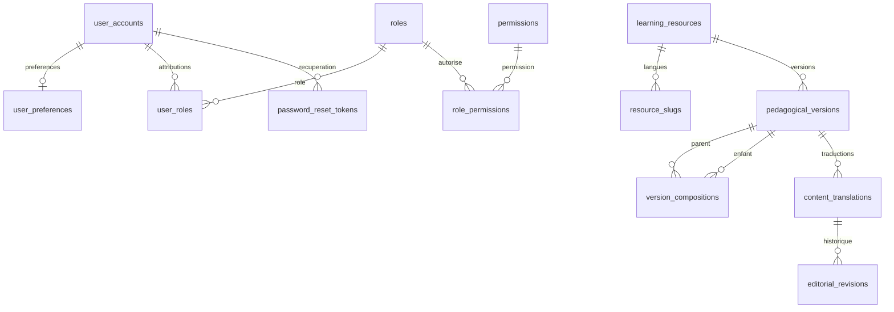

# Modèle relationnel — socles P03/P04

Les migrations sont la définition exécutable du schéma. Ce document distingue les tables livrées par P03/P04 des extensions à créer dans les lots métier. Aucun diagramme ne constitue une API ou un parcours déjà intégré.

## Identité et contenu présents

V001 conserve les deux tables officielles de Spring Session JDBC 4.1.1. V002 ajoute douze tables, sans données de démonstration et sans mécanisme concurrent de création automatique. V003 ajoute deux tables de sécurité, la version d’authentification et des références de permission ; ses règles sont détaillées ci-dessous.

| Table | Identité et relations | Invariants |
| --- | --- | --- |
| `user_accounts` | UUID, email normalisé unique, empreinte de mot de passe, statut, version d’authentification V003 | Inscription réelle en P04 ; statut anonymisé sans identifiants de connexion ; ni hash ni entité retournés au navigateur |
| `user_preferences` | UUID, FK utilisateur unique | Locale FR/EN, fuseau explicite ; ressource révisable distincte du compte |
| `roles`, `permissions` | UUID et code stable unique | Autorisations éditoriales et financières séparables ; aucun rôle fourni par un navigateur ne fait autorité |
| `user_roles`, `role_permissions` | UUID par attribution, FK explicites, révocation | Unicité des attributions actives, historique conservé ; révoquer ne réécrit ni ne supprime l’origine |
| `learning_resources` | UUID stable, type COURSE/MODULE/ACTIVITY | L’identité et le type ne changent pas avec le titre, la langue ou le slug ; archivage distinct de suppression |
| `pedagogical_versions` | UUID, FK ressource, numéro unique par ressource | Objectifs et définition d’évaluation ; gel irréversible après construction ; changement pédagogique ⇒ nouvelle version UUID |
| `version_compositions` | UUID, FK version parent/enfant, position | COURSE→MODULE→ACTIVITY ; enfant et position uniques par parent ; composition conservée pour chaque version |
| `resource_slugs` | UUID, FK composite ressource/type, langue, slug | Unique `(type, locale, slug)` et `(resource, locale)` ; slug canonique de l’identité, indépendant de la version |
| `content_translations` | UUID, FK version pédagogique, locale | Unique `(version, locale)` ; état éditorial et pointeurs de révision courante/publiée révisables |
| `editorial_revisions` | UUID, FK traduction, numéro, auteur éventuel | Instantané append-only ; numéro unique par traduction ; aucun UPDATE/DELETE d’une révision historique |

Les guides et modèles de méthodes n’appartiennent pas encore à l’enum COURSE/MODULE/ACTIVITY ; leur lot ajoutera leurs structures et contraintes. Aucun faux catalogue public n’est activé par ces tables.

## Identité et récupération — V003 / P04

[`V003__account_security_and_password_recovery.sql`](../apps/api/src/main/resources/db/migration/V003__account_security_and_password_recovery.sql) complète le schéma existant sans réécrire V001/V002. Les rôles, permissions et préférences réutilisent leurs tables P03 ; aucun second magasin d’identité n’est créé.

| Élément livré | Types, clés et relations | Contraintes PostgreSQL |
| --- | --- | --- |
| `user_accounts.authentication_version` | `BIGINT NOT NULL DEFAULT 0` ; distinct de la `revision` optimiste JPA | Borné à `0..9007199254740991` ; ne peut pas diminuer ; un changement de `password_hash` ou `status` impose au moins l’ancienne version + 1 |
| `password_reset_tokens` | PK UUID générée ; `user_id` UUID NOT NULL → `user_accounts(id)` **ON DELETE RESTRICT** ; `token_hash CHAR(64)` unique ; version d’authentification capturée à l’émission | Empreinte de 64 caractères hexadécimaux minuscules ; version bornée comme le compte ; dates UTC finies, `expires_at > created_at`, consommation nullable mais `consumed_at >= created_at` |
| `identity_rate_limits` | PK `bucket_key CHAR(64)`, début de fenêtre `TIMESTAMPTZ`, compteur entier ; aucune FK utilisateur | Clé hexadécimale minuscule de 64 caractères ; date de fenêtre finie ; compteur de `1..1000000` |

Les jetons ont des index sur `user_id` et `expires_at`, en plus de l’unique sur leur empreinte. Les quotas ont un index sur le début de fenêtre. L’absence de FK utilisateur des quotas est intentionnelle : une adresse inconnue suit la même limitation et la même réponse neutre qu’une adresse inscrite. La clé stockée est le SHA-256 de `password-reset:` suivi de l’email normalisé ; ni email brut ni IP ne sont enregistrés dans cette table.

La version d’authentification est une époque de révocation, pas une révision éditable par le navigateur. Le trigger `guard_account_authentication_version` s’applique aussi aux modifications SQL directes du hash/statut. Le service incrémente cette époque lors d’un reset ; un profil chargé en session avec une époque différente ou un compte inactif perd sa session. Les permissions sont rechargées indépendamment à chaque requête : retirer une attribution ne nécessite pas de changer cette époque. `@Version` conserve son rôle séparé contre les écritures concurrentes des entités et les préconditions ETag de préférences.

Le jeton transmis possède 32 octets aléatoires, encodés en 43 caractères base64url ; seule son empreinte SHA-256 est persistée. La version capturée dans la ligne est comparée à celle du compte par le service, sans FK composite vers une prétendue table d’historique. Le service verrouille d’abord le compte puis la ligne de jeton, vérifie compte actif, empreinte, époque, échéance et absence de consommation, remplace le hash et incrémente l’époque dans la même transaction. Il marque consommés tous les jetons encore inutilisés du compte et supprime ses sessions JDBC. Une seule consommation concurrente peut réussir ; l’émission prend aussi le verrou du compte pour ne pas émettre depuis une époque périmée.

Les contraintes de dates ne suffisent pas à garantir à elles seules l’usage unique ou l’autorisation : ces contrôles transactionnels appartiennent au service Spring. Les lignes de jetons ne sont pas déclarées append-only par un trigger ; leur consommation est une mutation prévue. Une ligne expirée reste refusée même si aucun nettoyage n’est encore passé. Les durées et quotas sont configurés côté serveur : expiration du lien 30 minutes ; trois demandes par adresse normalisée et fenêtre de quinze minutes. Le compteur est incrémenté par un `INSERT ... ON CONFLICT ... RETURNING` atomique, y compris pour les adresses inconnues ; la réponse publique reste 202 lorsque le quota est dépassé.

Spring Session conserve le schéma V001. Son champ texte `principal_name` contient l’UUID stable du compte authentifié, sans FK vers `user_accounts` ; l’index et la révocation par UUID relèvent du service. Les attributs de session sérialisent le principal sans mot de passe ni hash. L’invalidation supprime la session et ses attributs par le CASCADE officiel de V001. Expiration d’inactivité : 30 minutes, nettoyage Spring Session chaque minute. Les tables de jetons/quotas n’ont ni TTL PostgreSQL ni purge planifiée livrée par V003 ; leur rétention opérationnelle reste à définir, sans conditionner le refus d’un lien expiré.

La mise à niveau crée seulement les préférences techniques manquantes des comptes non anonymisés (`fr`, `UTC`), sans écraser une préférence existante ni lui attribuer de rôle. Elle ajoute le rôle de référence `LEARNER`, la permission `identity.preferences.write` et leur attribution active ; aucun utilisateur, mot de passe ou administrateur connu n’est inséré. Une nouvelle inscription attribue LEARNER dans sa transaction serveur ; le client ne choisit pas cette attribution.

Les tests PostgreSQL P04 vérifient notamment la mise à niveau depuis V002 en conservant hash, préférence révisée et session, la création des seules préférences manquantes, l’absence de rôle utilisateur automatique lors de cette réparation, la consommation concurrente, l’émission bloquée sur un changement de credentials et les quotas atomiques. Les tests HTTP vérifient en plus les sessions, la révocation effective et l’envoi SMTP réel ; leur état final est suivi dans [evidence/P04.md](evidence/P04.md).

## Versions, corrections et publication

Une version pédagogique fixe objectifs, évaluation et composition. Elle peut être construite tant qu’elle n’est pas gelée ; les versions enfants doivent être gelées avant leur parent. Le verrou de ligne du parent protège aussi les modifications concurrentes de sa composition. Après gel, ajout, modification, suppression de composition et modification de version sont refusés en base.

Une correction de texte ajoute une révision éditoriale sous **la même traduction et la même version pédagogique**. Une évolution d’objectif/évaluation crée une nouvelle version pédagogique ; les anciennes versions restent adressables pour les futures tentatives, productions et attestations. Les contenus traduits de versions équivalentes conservent les mêmes identifiants pédagogiques ; les révisions de texte restent propres à leur langue.

Les FK composites des pointeurs courants/publiés empêchent de publier une révision appartenant à une autre traduction ou version. La publication exige une pédagogie gelée. Le workflow complet, la revue de traduction et les permissions de publication seront réalisés en P05 ; un statut stocké ne remplace pas ces contrôles serveur.

Les slugs sont canoniques par type/langue. Les routes imbriquées d’activité vérifieront également l’appartenance au programme de la version du parcours. Changer un slug ne change pas la ressource ni ses acquis ; alias/redirections seront ajoutés avec le routage public, sans déduire un identifiant d’un titre.

## Types, concurrence et suppression

- UUID pour les identifiants et FK métier. Les identifiants de session historiques gardent le format officiel Spring Session de V001.
- Instants `Instant`/`timestamptz`, connexions JDBC et Hibernate en UTC. PostgreSQL conserve un instant ; le fuseau de préférence sert à l’affichage. Dates non finies et chronologies incohérentes refusées par contraintes.
- Révision numérique optimiste `@Version` sur les ressources modifiables ; les révisions éditoriales immuables ont leur numéro historique propre. Un ETag fort référence type, UUID et révision ; la précondition HTTP doit être associée au contrôle atomique Hibernate dans la transaction du futur cas d’utilisation.
- Montants futurs en `BIGINT` unités mineures avec devise explicite ; transport JSON limité aux entiers exacts JavaScript. Pas de `float`, pas d’hypothèse universelle de deux décimales. `Money`/OpenAPI vérifient syntaxe et bornes ; la liste des devises réellement autorisées appartiendra à la configuration commerciale serveur.
- Les FK métier sont `ON DELETE RESTRICT`. Les instantanés éditoriaux et attributions historiques sont protégés. L’anonymisation du compte est distincte de la suppression physique ; rétention et procédure d’effacement seront précisées dans les lots concernés. Seule la suppression des attributs de session suit le CASCADE officiel V001.
- Les liens JPA sont des UUID explicites, sans graphes sérialisés ni cascades implicites. Les DTO publics sont construits par mapping ; les entités ne sont pas des réponses HTTP.

## Relations réservées aux lots suivants — non migrées en P03/P04

Les noms suivants expriment les clés et règles attendues. Ils seront concrétisés par migrations additionnelles avec leur fonctionnalité et ses tests, sans CRUD anticipé.

| Lot | Relations/contraintes à introduire | Conservation obligatoire |
| --- | --- | --- |
| P07 méthodes | Copie personnelle UUID, propriétaire FK, texte/paramètres/langue propres, révision optimiste ; origine vers modèle/version/révision source | Nouvelle source ou archivage ne met jamais à jour le texte de la copie ; supprimer un droit n’efface pas la copie |
| P08 apprentissage | Inscription unique `(user, course)` ; acquis référencés par identité/version équivalente ; tentative quiz → utilisateur, activité/version, version des questions, locale | Historique des tentatives et barème conservés ; position média unique par utilisateur/média, distincte des acquis FR/EN |
| P09 productions | Projet → propriétaire, activité et version pédagogique ; révision de projet append-only ; autoévaluation → révision soumise, grille versionnée, provenance déclarative | Corrigé consulté, autoévaluation et revue humaine restent des preuves distinctes ; aucune cascade depuis achat/droit |
| P10 fichiers | Métadonnées UUID, propriétaire, clé objet serveur, statut ; FK au projet/révision si nécessaire | Vérification d’accès à chaque nouvel accès temporaire, aucune URL libre choisie par le navigateur |
| P11 commandes | Commande → propriétaire ; lignes → snapshot offre/révision ; ressources promises → UUID ressource, version/politique et langues ; montant/devise/conditions figés | Ni changement de pack ni nouvelle offre ne modifie les lignes achetées ; aucun total autoritaire reçu du navigateur |
| P12 paiements | Opération fournisseur → commande, mode/compte fournisseur, montant/devise ; événements entrants uniques par fournisseur/compte/mode/identifiant ; clés d’idempotence liées à utilisateur/opération/empreinte | Réception durable et effet métier uniques séparément ; paiement réussi et activation en attente peuvent coexister |
| P12 droits | Attribution UUID → utilisateur, ressource/version/politique, origine **FK vérifiable** (ligne-ressource achetée ou origine manuelle explicite), périodes/langues | Unicité par origine et ressource, jamais seulement `(user, course)` ; chaque achat individuel et pack conserve sa propre attribution |
| P13 remboursements | Remboursement → paiement, allocations de lignes et décision d’accès explicite ; réservation des montants en cours et idempotence | Réussite financière distincte de demande ; retrait des seules origines concernées après confirmation, jamais des productions/progrès |
| P14 attestations | Attestation → utilisateur, version pédagogique et références exactes de preuves/révisions émises | Une nouvelle version ne réécrit pas l’attestation ; aucune certification ou correction humaine déduite d’une autoévaluation |

L’origine d’un droit ne sera pas un simple couple texte/UUID sans intégrité : les migrations concernées définiront des FK vers l’origine réelle et une contrainte d’exclusivité entre types d’origine. Une attribution révoquée garde son historique ; une ancienne notification de paiement ne pourra pas la réactiver. Si A a été acheté seul puis dans A+B, le remboursement du pack retire uniquement ses origines ; A reste couvert par l’achat individuel.

Les suppressions physiques et opérations financières nécessiteront des cas d’utilisation explicites. Aucun remboursement ne déclenchera une cascade vers notes, projets, méthodes, tentatives ou attestations.

## Données locales et preuves

Les migrations structurelles ne contiennent aucune fixture ni prix. Les références de permission V003 sont distinctes des comptes et données de démonstration. Le chargement explicite local et les fixtures Testcontainers sont séparés, identifiés comme fictifs, réexécutables et interdits en production. Le suivi des commandes et résultats réellement exécutés est dans [evidence/P03.md](evidence/P03.md) et [evidence/P04.md](evidence/P04.md).

Références techniques consultées : [contraintes PostgreSQL 18](https://www.postgresql.org/docs/18/ddl-constraints.html), [instants PostgreSQL 18](https://www.postgresql.org/docs/18/datatype-datetime.html), [Spring Boot SQL](https://docs.spring.io/spring-boot/reference/data/sql.html), [Hibernate ORM 7.4](https://docs.hibernate.org/orm/7.4/userguide/html_single/). Les règles commerciales restent celles de [PRODUCT.md](PRODUCT.md) et [DECISIONS.md](DECISIONS.md).
