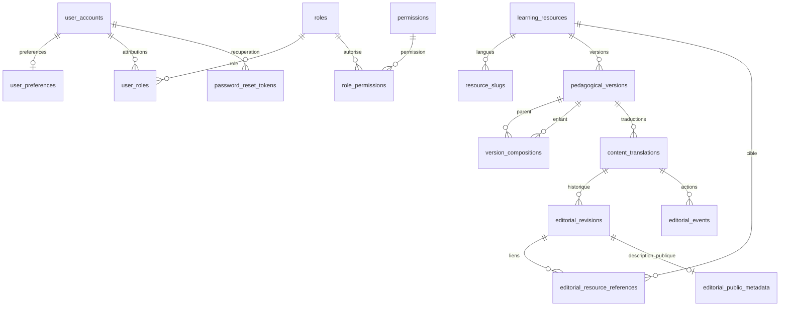

# Modèle relationnel — socles P03 à P06

Les migrations sont la définition exécutable du schéma. Ce document distingue les tables livrées par P03 à P06 des extensions à créer dans les lots métier. Les preuves de chaque lot indiquent le niveau de validation réellement exécuté.

## Identité et contenu présents

V001 conserve les deux tables officielles de Spring Session JDBC 4.1.1. V002 ajoute douze tables, sans données de démonstration et sans mécanisme concurrent de création automatique. V003 ajoute deux tables de sécurité, la version d’authentification et des références de permission. V004 étend les instantanés éditoriaux et ajoute deux tables d’historique et de références. V005 ajoute les métadonnées publiques par révision et les instantanés de revue/source publiées. V001 à V004 restent inchangées.

| Table | Identité et relations | Invariants |
| --- | --- | --- |
| `user_accounts` | UUID, email normalisé unique, empreinte de mot de passe, statut, version d’authentification V003 | Inscription réelle en P04 ; statut anonymisé sans identifiants de connexion ; ni hash ni entité retournés au navigateur |
| `user_preferences` | UUID, FK utilisateur unique | Locale FR/EN, fuseau explicite ; ressource révisable distincte du compte |
| `roles`, `permissions` | UUID et code stable unique | Autorisations éditoriales et financières séparables ; aucun rôle fourni par un navigateur ne fait autorité |
| `user_roles`, `role_permissions` | UUID par attribution, FK explicites, révocation | Unicité des attributions actives, historique conservé ; révoquer ne réécrit ni ne supprime l’origine |
| `learning_resources` | UUID stable, type COURSE/MODULE/ACTIVITY/GUIDE/METHOD_TEMPLATE ; origine de duplication éventuelle | L’identité, le type et l’origine ne changent pas avec le titre, la langue ou le slug ; archivage distinct de suppression |
| `pedagogical_versions` | UUID, FK ressource, numéro unique par ressource ; version remplacée éventuelle | Objectifs et définition d’évaluation ; gel irréversible après construction ; changement pédagogique ⇒ nouvelle version UUID ; remplacement limité à la même identité |
| `version_compositions` | UUID, FK version parent/enfant, position | COURSE→MODULE→ACTIVITY ; enfant et position uniques par parent ; composition conservée pour chaque version |
| `resource_slugs` | UUID, FK composite ressource/type, langue, slug | Unique `(type, locale, slug)` et `(resource, locale)` ; slug canonique de l’identité, indépendant de la version |
| `content_translations` | UUID, FK version pédagogique, locale ; source, révisions examinées, date de vérification | Unique `(version, locale)` ; état éditorial et pointeurs de révision courante/publiée révisables ; langue source différente sur la même version |
| `editorial_revisions` | UUID, FK traduction, numéro, auteur éventuel, document JSONB, motif et révision remplacée | Instantané append-only ; numéro unique par traduction ; aucun UPDATE/DELETE d’une révision historique ; remplacement limité à la même traduction |
| `editorial_events` | UUID, traduction, révision concernée, acteur obligatoire, type, motif et date | Journal append-only des actions éditoriales ; FK de révision composite avec sa traduction |
| `editorial_resource_references` | PK composite `(revision_id, resource_id)` et deux FK RESTRICT | Projection append-only des liens du document vers les identités réelles ; aucune réécriture d’un lien historique |
| `editorial_public_metadata` | PK `revision_id`, FK RESTRICT vers une révision, description publique JSONB et date UTC | Une description par instantané éditorial ; UPDATE/DELETE refusés ; aucune donnée commerciale créée |

GUIDE et METHOD_TEMPLATE sont des feuilles éditoriales depuis V004. Les copies personnelles de méthodes restent distinctes et seront ajoutées en P07. Ces structures ne créent aucun prix, droit payant ou contenu pédagogique final.

## Identité et récupération — V003 / P04

[`V003__account_security_and_password_recovery.sql`](../apps/api/src/main/resources/db/migration/V003__account_security_and_password_recovery.sql) complète le schéma existant sans réécrire V001/V002. Les rôles, permissions et préférences réutilisent leurs tables P03 ; aucun second magasin d’identité n’est créé.

| Élément livré | Types, clés et relations | Contraintes PostgreSQL |
| --- | --- | --- |
| `user_accounts.authentication_version` | `BIGINT NOT NULL DEFAULT 0` ; distinct de la `revision` optimiste JPA | Borné à `0..9007199254740991` ; ne peut pas diminuer ; un changement de `password_hash` ou `status` impose au moins l’ancienne version + 1 |
| `password_reset_tokens` | PK UUID générée ; `user_id` UUID NOT NULL → `user_accounts(id)` **ON DELETE RESTRICT** ; `token_hash CHAR(64)` unique ; version d’authentification capturée à l’émission | Empreinte de 64 caractères hexadécimaux minuscules ; version bornée comme le compte ; dates UTC finies, `expires_at > created_at`, consommation nullable mais `consumed_at >= created_at` |
| `identity_rate_limits` | PK `bucket_key CHAR(64)`, début de fenêtre `TIMESTAMPTZ`, compteur entier ; aucune FK utilisateur | Clé hexadécimale minuscule de 64 caractères ; date de fenêtre finie ; compteur de `1..1000000` |

Les jetons ont des index sur `user_id` et `expires_at`, en plus de l’unique sur leur empreinte. Les quotas ont un index sur le début de fenêtre. L’absence de FK utilisateur des quotas est intentionnelle : une adresse inconnue suit la même limitation et la même réponse neutre qu’une adresse inscrite. La clé stockée est le SHA-256 de `password-reset:` suivi de l’email normalisé ; ni email brut ni IP ne sont enregistrés dans cette table.

La version d’authentification est une époque de révocation, pas une révision éditable par le navigateur. Le trigger `guard_account_authentication_version` s’applique aussi aux modifications SQL directes du hash/statut. Le service incrémente cette époque lors d’un reset ; un profil chargé en session avec une époque différente ou un compte inactif perd sa session. Les permissions sont rechargées indépendamment à chaque requête : retirer une attribution ne nécessite pas de changer cette époque. `@Version` conserve son rôle séparé contre les écritures concurrentes des entités et les préconditions ETag de préférences.

Le jeton transmis possède 32 octets aléatoires, encodés en 43 caractères base64url ; seule son empreinte SHA-256 est persistée. La version capturée dans la ligne est comparée à celle du compte par le service, sans FK composite vers une prétendue table d’historique. Le service verrouille d’abord le compte puis la ligne de jeton, vérifie compte actif, empreinte, époque, échéance et absence de consommation, remplace le hash et incrémente l’époque dans la même transaction. Il marque consommés tous les jetons encore inutilisés du compte et supprime ses sessions JDBC. Une seule consommation concurrente peut réussir ; l’émission prend aussi le verrou du compte pour ne pas émettre depuis une époque périmée.

Les contraintes de dates ne suffisent pas à garantir à elles seules l’usage unique ou l’autorisation : ces contrôles transactionnels appartiennent au service Spring. Les lignes de jetons ne sont pas déclarées append-only par un trigger ; leur consommation est une mutation prévue. Une ligne expirée reste refusée même si aucun nettoyage n’est encore passé. Les durées et quotas sont configurés côté serveur : expiration du lien 30 minutes ; trois demandes par adresse normalisée et fenêtre de quinze minutes. Le compteur est incrémenté par un `INSERT ... ON CONFLICT ... RETURNING` atomique, y compris pour les adresses inconnues ; la réponse publique reste 202 lorsque le quota est dépassé.

Spring Session conserve le schéma V001. Son champ texte `principal_name` contient l’UUID stable du compte authentifié, sans FK vers `user_accounts` ; l’index et la révocation par UUID relèvent du service. Les attributs de session sérialisent le principal sans mot de passe ni hash. L’invalidation supprime la session et ses attributs par le CASCADE officiel de V001. Expiration d’inactivité : 30 minutes, nettoyage Spring Session chaque minute. Les tables de jetons/quotas n’ont ni TTL PostgreSQL ni purge planifiée livrée par V003 ; leur rétention opérationnelle reste à définir, sans conditionner le refus d’un lien expiré.

La mise à niveau crée seulement les préférences techniques manquantes des comptes non anonymisés (`fr`, `UTC`), sans écraser une préférence existante ni lui attribuer de rôle. Elle ajoute le rôle de référence `LEARNER`, la permission `identity.preferences.write` et leur attribution active ; aucun utilisateur, mot de passe ou administrateur connu n’est inséré. Une nouvelle inscription attribue LEARNER dans sa transaction serveur ; le client ne choisit pas cette attribution.

Les tests PostgreSQL P04 vérifient notamment la mise à niveau depuis V002 en conservant hash, préférence révisée et session, la création des seules préférences manquantes, l’absence de rôle utilisateur automatique lors de cette réparation, la consommation concurrente, l’émission bloquée sur un changement de credentials et les quotas atomiques. Les tests HTTP vérifient en plus les sessions, la révocation effective et l’envoi SMTP réel ; leur état final est suivi dans [evidence/P04.md](evidence/P04.md).

## Édition, versions et publication — V004 / P05

[`V004__editorial_workflow_and_structured_content.sql`](../apps/api/src/main/resources/db/migration/V004__editorial_workflow_and_structured_content.sql) conserve les identités, textes, sessions et attributions antérieurs. Les opérations sont définies par `EditorialService` : création, révision, duplication, nouvelle version pédagogique, traduction, composition, revue, publication et archivage. L’UUID `id` du document CMS désigne une **traduction d’une version** ; `resourceId` et `versionId` restent exposés séparément. Il n’existe pas de suppression physique dans l’API éditoriale.

| Ajout V004 | Intégrité en base | Contrôle du cas d’utilisation |
| --- | --- | --- |
| `learning_resources.duplicated_from_id` | FK RESTRICT et origine immuable | Duplication explicite vers une nouvelle identité, en brouillon |
| `pedagogical_versions.replaces_version_id` | FK composite vers `(id, resource_id)`, pas d’auto-référence, origine immuable | Numéro suivant alloué sous le verrou de l’identité ; anciennes versions conservées |
| `editorial_revisions.document_json`, `reason`, `replaces_revision_id` | JSONB objet ou NULL historique, représentation texte en base ≤65 536 octets ; motif non vide ≤1 000 caractères ; remplacement dans la même traduction | Document sérialisé ≤48 KiB UTF-8 et structure bornée ; ajout d’une nouvelle ligne, auteur et motif enregistrés |
| Source et revue de `content_translations` | FK composites des révisions source/examinées ; origine source immuable ; source dans l’autre langue et même version ; date de vérification UTC finie | Revue de la révision courante et de la source déterminée, état périmé si la source a changé |
| `editorial_events` | Acteur et traduction obligatoires ; révision appartenant à cette traduction ; UPDATE/DELETE refusés | Une action enregistre son type, son motif et son instantané concerné dans la transaction |

Le document contient objectif localisé, résultat attendu, prérequis, blocs de texte typés, durée estimée optionnelle, exercice/corrigé, quiz avec explications et points, grille déclarative, politique FREE/PROTECTED et références. Les liens acceptent uniquement HTTPS sans identifiants ou un chemin interne simple ; le texte ne devient jamais du HTML/MDX exécutable. Les limites comprennent 60 blocs, 20 questions avec 2 à 8 options, 30 critères, 20 médias, 30 ressources liées et 100 versions enfants. Les points vont de 1 à 1 000 par question/critère ; les clés d’évaluation sont uniques dans leur liste. Le service applique ces contrôles même en dehors d’un contrôleur HTTP.

Une version pédagogique fixe objectifs, évaluation et composition. Elle peut être construite tant qu’elle n’est pas gelée ; les versions enfants doivent être gelées avant leur parent. Le verrou de ligne du parent protège aussi les modifications concurrentes de sa composition. Après gel, ajout, modification, suppression de composition et modification de version sont refusés en base.

Une correction de texte ajoute une révision éditoriale sous **la même traduction et la même version pédagogique**. Une évolution d’objectif/évaluation crée une nouvelle version pédagogique ; les anciennes versions restent adressables pour les futures tentatives, productions et attestations. Après gel, la politique P05 compare conservativement objectif localisé, exercice/corrigé, questions et grille avec la révision précédente de la même langue : une différence exige une nouvelle version, même si l’auteur la considère mineure. La première traduction non publiée peut compléter ces champs malgré le gel partagé ; la revue impose alors les mêmes clés, points, nombre d’options, index de réponse juste et structure de grille que sa source. Les textes traduits peuvent différer. Cette vérification structurelle accompagne la revue humaine enregistrée ; elle ne démontre pas automatiquement l’équivalence sémantique des traductions.

Les FK composites des pointeurs courants/publiés empêchent de publier une révision appartenant à une autre traduction ou version. Le cycle est DRAFT → TO_REVIEW → READY → PUBLISHED. READY enregistre `reviewed_revision_id`, la source examinée et `verified_at` depuis une action réelle de revue. `source_revision_id` conserve l’origine de la traduction ; `reviewed_source_revision_id` avance uniquement lors d’une nouvelle revue. Une correction revient DRAFT tout en conservant le pointeur de publication précédent. Une source corrigée, marquée STALE ou archivée fait passer ses traductions examinées à STALE sans modifier leurs textes historiques. Les transitions invalides sont refusées ; l’archivage explicite est possible depuis les états non archivés et conserve les instantanés.

`readiness` évalue les champs et dépendances structurels ; un brouillon complet peut donc être structurellement prêt sans avoir encore été revu. Une activité nécessite objectif, résultat, contenu, exercice, corrigé et grille. Un parent nécessite des enfants publiés dans la même langue et déjà gelés. Une ressource liée doit avoir une publication dans cette langue. Une référence média/fichier obligatoire reste `MEDIA_UNVERIFIED` et bloque : P05 n’invente aucun état de stockage disponible avant P10. Une référence facultative non vérifiée et une durée non estimée produisent des avertissements. L’absence de document structuré historique bloque également.

La publication prend un `revisionId` déterminé et un motif. Dans sa transaction, le service exige READY, la révision courante demandée, une revue toujours applicable à cette révision et à la source courante, puis revérifie la readiness. Il gèle la version si nécessaire avant de déplacer le pointeur publié. La permission est vérifiée une première fois puis après l’attente des verrous. Une ancienne réponse readiness n’autorise aucune publication ultérieure à elle seule.

Les dépendances exposent les compositions entrantes, références éditoriales et traductions sources, avec les conséquences d’un archivage. Ce graphe est **informatif** : P05 ne propage pas automatiquement STALE à tous les parcours ou guides qui citent une ressource et n’exécute aucune migration de futurs progrès, projets ou attestations. Une composition ne peut plus être réordonnée après gel ; créer une nouvelle version du parent permet une autre composition sans déplacer les historiques.

### Concurrence et autorisation éditoriales

Le rôle de référence EDITOR reçoit `content.read`, `content.write`, `content.review`, `content.publish` et `content.archive`. V004 ne crée aucun compte, mot de passe ou attribution utilisateur, et n’ajoute aucune permission de commerce. Les filtres HTTP et chaque service contrôlent les permissions stockées, sans faire confiance aux rôles d’un corps client.

Les écritures JDBC appartiennent à une transaction de cas d’utilisation. Elles verrouillent d’abord l’identité stable, puis ses versions et traductions dans un ordre déterminé. `If-Match` est comparé à la révision rechargée **après l’attente** ; une requête concurrente dépassée reçoit 412. Le service revérifie ensuite la permission, notamment si elle a été retirée pendant l’attente. Le verrou de famille complète le compteur de révision ; l’API n’expose pas une écriture directe contournant ce chemin.

Une vue contient aussi l’état des autres langues et la date de gel. Toute mutation augmente donc les révisions des documents de la même identité, afin que l’ETag fort `content-{id}-r{revision}` change avec ces informations. Les lectures de vue, liste, historique, readiness, dépendances et projection publique utilisent REPEATABLE_READ pour lire un même instantané PostgreSQL sur leurs requêtes successives. La date de revue n’est pas modifiée par un déploiement ni par ce changement de compteur.

### Mise à niveau et projection publique

V004 ajoute un document NULL aux révisions P03 existantes sans toucher à leur `body`. Les vues privées et l’historique exposent ce texte sous `legacyBody` lorsque `document` est NULL ; l’interface le rend comme texte échappé. Il peut ainsi être consulté et copié pour une conversion explicite ; le serveur ne fabrique pas un document prêt à publier. Le chargement local P03 peut être réexécuté et conserve son identité, ses textes, les modifications manuelles et les pointeurs déjà présents. Les tests PostgreSQL couvrent base vide, mise à niveau V003, six instantanés historiques et marqueur de session conservés.

La projection publique sélectionne d’abord la dernière version possédant une publication, toutes langues confondues, puis exige la langue demandée sur cette version. Une traduction manquante produit 404 ; une traduction STALE expose uniquement les métadonnées publiées avec cette indisponibilité explicite. L’archivage de la dernière publication produit 404 sans réafficher silencieusement une ancienne version. Le document publié précédent reste consultable pendant une correction en brouillon, sous réserve de ces contrôles de source et d’archivage. Cette route ne remplace pas la future lecture historique par version et droits achetés.

FREE utilise `PublicDocument`, qui omet les champs de corrigé, réponse juste et explication de quiz ; les modalités de révélation contrôlée appartiennent à P08. PROTECTED et STALE ont `document=null`, sans texte premium ni solutions envoyés puis masqués par l’interface. Aucun brouillon ni `legacyBody` n’est présent dans cette réponse publique.

Les slugs sont canoniques par type/langue. Les routes imbriquées d’activité vérifieront également l’appartenance au programme de la version du parcours. Changer un slug ne change pas la ressource ni ses acquis ; alias/redirections seront ajoutés avec le routage public, sans déduire un identifiant d’un titre.

## Métadonnées et catalogue public — V005 / P06

[`V005__public_catalogue_metadata_and_publication_snapshots.sql`](../apps/api/src/main/resources/db/migration/V005__public_catalogue_metadata_and_publication_snapshots.sql) conserve les textes, identités, versions, sessions et comptes existants. Elle n’insère ni ressource, ni prix, ni compte éditeur. Le catalogue est une projection des tables éditoriales, sans copie parallèle de données à maintenir.

| Élément V005 | Types et intégrité | Règle de service |
| --- | --- | --- |
| `editorial_public_metadata` | `revision_id` UUID PK/FK RESTRICT ; `metadata_json` JSONB objet, représentation texte en base ≤32 768 octets ; `created_at` UTC finie ; trigger append-only | Métadonnées sérialisées ≤16 KiB UTF-8, listes et champs bornés ; aucune modification d’un instantané antérieur |
| `content_translations.published_verified_at` | `TIMESTAMPTZ` nullable, finie et ≥ création de la traduction | Copie de `verified_at` lors de la publication ; une revue du prochain brouillon ne déplace pas la date de la publication encore visible |
| `content_translations.published_source_revision_id` | UUID nullable, FK composite vers la révision de `source_translation_id` | Copie de `reviewed_source_revision_id` lors de la publication ; READY seul ne rend pas à nouveau public un corps de traduction dépassé |

Les métadonnées contiennent tâches couvertes, niveau, public concerné, outils, sources, FAQ et description publique des modalités d’évaluation. Les tâches configurables viennent du dossier de référence : `understand-brief`, `define-scope`, `prepare-prompt`, `build-proposal`, `check-output`, `reuse-method`. Les niveaux sont `BEGINNER`, `INTERMEDIATE`, `ADVANCED` ou NULL. Aucune tâche ni aucun niveau n’est déduit automatiquement d’un titre. Une révision historique sans métadonnées expose un objet vide avec niveau/modalités NULL, sans inventer public, outils ou sources.

Les bornes incluent six tâches sans doublons, dix publics de 500 caractères, dix outils de nom 120 caractères, vingt sources de libellé 240 caractères, douze FAQ de question 500/réponse 2 000 caractères et des modalités optionnelles de 4 000 caractères. Les URL sont bornées à 2 000 caractères, HTTPS sans identifiants ou chemin interne simple. L’enregistrement d’une URL ne prétend pas qu’un fournisseur de média ou une vérification automatique de cette page existe.

`PUT /admin/contents/{id}/metadata` exige CSRF, `content.write` et If-Match. Le service ajoute une révision éditoriale avec le même document et les nouvelles métadonnées, repasse DRAFT et conserve la publication précédente. Une correction ordinaire conserve les métadonnées courantes ; duplication et nouvelle version en recopient un instantané en brouillon. Une nouvelle traduction commence avec des métadonnées vides, sans texte français présenté comme anglais. Les anciennes révisions et leurs métadonnées ne changent pas. Le texte historique `document=null` doit être converti explicitement avant cette commande.

### Revue publiée et mise à niveau conservatrice

La publication capture sa date de revue et la révision source examinée dans les deux nouvelles colonnes, dans la transaction qui déplace le pointeur publié. Les contrôles publics comparent ensuite la **source publiée examinée** à la source courante ; les colonnes de revue d’un prochain brouillon restent distinctes. Les événements READY/PUBLISH et les révisions antérieures sont conservés.

À la mise à niveau, une traduction dans l’état PUBLISHED copie ses valeurs de revue existantes. Pour un autre état possédant une ancienne publication, V005 récupère seulement une date de revue READY de cette révision située avant son événement PUBLISH, lorsqu’elle existe. Sans preuve, la date reste NULL. La source examinée d’une publication ancienne en cours de correction ne peut pas être reconstruite avec certitude depuis le journal P05 ; elle reste NULL. Une traduction ainsi incertaine est considérée STALE par la projection publique jusqu’à une revue puis publication explicites. Cette précaution ne réécrit ni ses textes, ni ses anciens pointeurs, ni son état éditorial stocké.

### Recherche, facettes et programmes

`PublicCatalogueService` lit en REPEATABLE_READ. La recherche combine texte `q` (titre/résumé/slug/objectif de description), type, tâche, niveau, langue et accès, avec pagination serveur `page`/`pageSize` de 1 à 100 éléments. Les valeurs sont validées et les requêtes paramétrées ; `%` et `_` d’une saisie sont recherchés littéralement. Les cartes portent COURSE, ACTIVITY, GUIDE ou METHOD_TEMPLATE ; MODULE est réservé au programme.

Un couple identité/langue n’apparaît qu’une fois : le service choisit la dernière version ayant une publication toutes langues confondues, puis exige une publication disponible de cette version dans la langue demandée. Brouillon sans publication, retrait, traduction manquante et STALE sont exclus côté SQL. Une correction en brouillon laisse uniquement son ancien instantané publié disponible. Les facettes et leurs comptes viennent des mêmes publications disponibles ; les catégories vides ne sont pas présentées comme couvertes.

TITLE trie le titre normalisé avec collation C puis l’UUID stable. RECENT trie l’instant du véritable événement PUBLISH de la révision publiée, puis l’UUID ; les historiques sans événement connu sont placés en dernier. Une date de revue différente n’est pas transformée en nouvelle publication. La pagination et le tri ne dépendent ni d’un prix ni d’un état d’accès personnel.

Les détails fournissent PUBLISHED, MISSING_TRANSLATION, STALE ou WITHDRAWN et les langues équivalentes de la même identité/version. La résolution par slug vérifie type et langue exacts. Une identité sans publication est 404 ; une identité connue mais indisponible dans cette langue est décrite sans emprunter le corps d’une autre langue ou d’une autre version. La recherche ne réactive pas une ancienne version après retrait de la plus récente.

Le programme suit exactement `version_compositions.child_version_id`. Une requête récursive de métadonnées couvre COURSE→MODULE→ACTIVITY dans l’ordre enregistré ; elle ne recharge pas les corps des leçons et ne remplace pas l’enfant par sa version globalement la plus récente. Le retrait d’une ancienne activité épinglée apparaît comme WITHDRAWN à cet endroit, même si une version suivante reste publiée ailleurs. L’endpoint de version exacte permet d’ouvrir le contexte réellement sélectionné par le programme.

Les objectifs, résultats, prérequis et durées de description constituent des champs publics explicites. Une durée absente reste NULL. Le corps détaillé reste limité à FREE et PUBLISHED et utilise le DTO sans solutions P05 ; PROTECTED ne livre aucun bloc, exercice, quiz, grille ni corrigé. Les modalités viennent de `metadata.evaluationDescription`, jamais de la définition pédagogique canonique privée. Les lectures sont `no-store` tant qu’une invalidation de cache à la publication n’est pas implémentée ; aucun cache partagé de personnalisation n’est introduit.

Une ancienne version **FREE, publiée, non retirée et disponible dans la langue demandée** peut être lue par son UUID exact, notamment dans un ancien programme. Cette lecture publique explicite est différente du repli silencieux de la recherche courante, qui est interdit. Elle n’accorde aucun droit payant et ne remplace pas la future politique privée de version achetée. Les offres, prix, achats, accès personnels, tentatives et progrès restent dans leurs lots respectifs. Les tests locaux couvrent notamment l’upgrade V004, les instantanés publiés, filtres/tri/pagination, pinning et absence de solutions/premium ; résultats détaillés dans [evidence/P06.md](evidence/P06.md).

## Types, concurrence et suppression

- UUID pour les identifiants et FK métier. Les identifiants de session historiques gardent le format officiel Spring Session de V001.
- Instants `Instant`/`timestamptz`, connexions JDBC et Hibernate en UTC. PostgreSQL conserve un instant ; le fuseau de préférence sert à l’affichage. Dates non finies et chronologies incohérentes refusées par contraintes.
- Révision numérique optimiste `@Version` sur les entités modifiables ; les révisions éditoriales immuables ont leur numéro historique propre. Les préférences associent If-Match et contrôle Hibernate ; le CMS JDBC associe compteur, verrou de famille et comparaison transactionnelle après attente.
- Montants futurs en `BIGINT` unités mineures avec devise explicite ; transport JSON limité aux entiers exacts JavaScript. Pas de `float`, pas d’hypothèse universelle de deux décimales. `Money`/OpenAPI vérifient syntaxe et bornes ; la liste des devises réellement autorisées appartiendra à la configuration commerciale serveur.
- Les FK métier sont `ON DELETE RESTRICT`. Les instantanés éditoriaux et attributions historiques sont protégés. L’anonymisation du compte est distincte de la suppression physique ; rétention et procédure d’effacement seront précisées dans les lots concernés. Seule la suppression des attributs de session suit le CASCADE officiel V001.
- Les liens JPA sont des UUID explicites, sans graphes sérialisés ni cascades implicites. Les DTO publics sont construits par mapping ; les entités ne sont pas des réponses HTTP.

## Relations réservées aux lots suivants — non migrées en P03 à P06

Les noms suivants expriment les clés et règles attendues. Ils seront concrétisés par migrations additionnelles avec leur fonctionnalité et ses tests, sans CRUD anticipé.

| Lot | Relations/contraintes à introduire | Conservation obligatoire |
| --- | --- | --- |
| P07 méthodes | Copie personnelle UUID, propriétaire FK, texte/paramètres/langue propres, révision optimiste ; origine vers modèle/version/révision source | Nouvelle source ou archivage ne met jamais à jour le texte de la copie ; supprimer un droit n’efface pas la copie |
| P08 apprentissage | Inscription unique `(user, course)` ; acquis référencés par identité/version équivalente ; tentative quiz → utilisateur, activité/version, version des questions, locale | Historique des tentatives et barème conservés ; position média unique par utilisateur/média, distincte des acquis FR/EN |
| P09 productions | Projet → propriétaire, activité et version pédagogique ; révision de projet append-only ; autoévaluation → révision soumise, grille versionnée, provenance déclarative | Corrigé consulté, autoévaluation et revue humaine restent des preuves distinctes ; aucune cascade depuis achat/droit |
| P10 fichiers | Métadonnées UUID, propriétaire, clé objet serveur, statut ; FK au projet/révision si nécessaire | Vérification d’accès à chaque nouvel accès temporaire, aucune URL libre choisie par le navigateur |
| P11 commandes | Commande → propriétaire ; lignes → snapshot offre/révision ; ressources promises → UUID ressource, version/politique et langues ; montant/devise/conditions figés | Ni changement de pack ni nouvelle offre ne modifie les lignes achetées ; aucun total autoritaire reçu du navigateur |
| P12 paiements | Opération fournisseur → commande, mode/compte fournisseur, montant/devise ; événements entrants uniques par fournisseur/compte/mode/identifiant ; clés d’idempotence liées à utilisateur/opération/empreinte | Réception durable et effet métier uniques séparément ; paiement réussi et activation en attente peuvent coexister |
| P12 droits | Attribution UUID → utilisateur, ressource/version/politique, origine **FK vérifiable** (ligne-ressource achetée ou origine manuelle explicite), périodes/langues | Unicité par origine et ressource, jamais seulement `(user, course)` ; chaque achat individuel et pack conserve sa propre attribution |
| P13 remboursements | Remboursement → paiement, allocations de lignes et décision d’accès explicite ; réservation des montants en cours et idempotence | Réussite financière distincte de demande ; retrait des seules origines concernées après confirmation, jamais des productions/progrès |
| P14 attestations | Attestation → utilisateur, version pédagogique et références exactes de preuves/révisions émises | Une nouvelle version ne réécrit pas l’attestation ; aucune certification ou correction humaine déduite d’une autoévaluation |

L’origine d’un droit ne sera pas un simple couple texte/UUID sans intégrité : les migrations concernées définiront des FK vers l’origine réelle et une contrainte d’exclusivité entre types d’origine. Une attribution révoquée garde son historique ; une ancienne notification de paiement ne pourra pas la réactiver. Si A a été acheté seul puis dans A+B, le remboursement du pack retire uniquement ses origines ; A reste couvert par l’achat individuel.

Les suppressions physiques et opérations financières nécessiteront des cas d’utilisation explicites. Aucun remboursement ne déclenchera une cascade vers notes, projets, méthodes, tentatives ou attestations.

## Données locales et preuves

Les migrations structurelles ne contiennent aucune fixture ni prix. Les références de permission V003/V004 sont distinctes des comptes et données de démonstration. Le chargement explicite local et les fixtures Testcontainers sont séparés, identifiés comme fictifs, réexécutables et interdits en production. Le suivi des commandes et résultats réellement exécutés est dans [evidence/P03.md](evidence/P03.md), [evidence/P04.md](evidence/P04.md), [evidence/P05.md](evidence/P05.md) et [evidence/P06.md](evidence/P06.md).

Références techniques consultées : [contraintes PostgreSQL 18](https://www.postgresql.org/docs/18/ddl-constraints.html), [instants PostgreSQL 18](https://www.postgresql.org/docs/18/datatype-datetime.html), [Spring Boot SQL](https://docs.spring.io/spring-boot/reference/data/sql.html), [Hibernate ORM 7.4](https://docs.hibernate.org/orm/7.4/userguide/html_single/). Les règles commerciales restent celles de [PRODUCT.md](PRODUCT.md) et [DECISIONS.md](DECISIONS.md).

Consultées le 8 novembre 2026 pour P05 : [isolation PostgreSQL 18](https://www.postgresql.org/docs/18/transaction-iso.html), distinguant l’instantané par requête de READ_COMMITTED et celui de REPEATABLE_READ ; [configuration `@Transactional`](https://docs.spring.io/spring-framework/reference/data-access/transaction/declarative/annotations.html), pour les transactions des cas d’utilisation. La page Spring flottante consultée affichait 7.0.10 ; elle ne change pas le BOM installé décrit dans VERSIONS.md.
